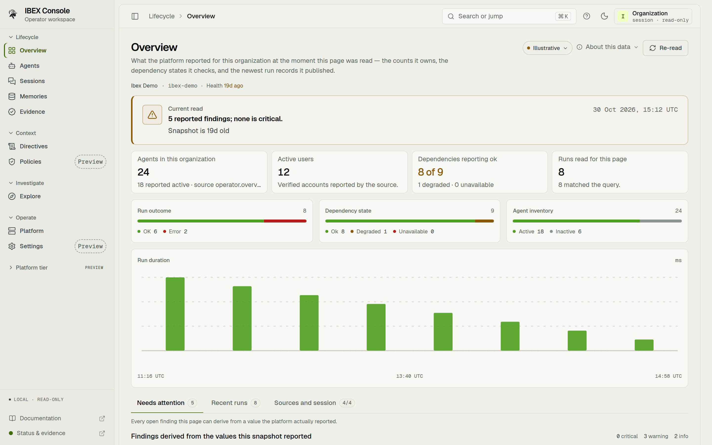
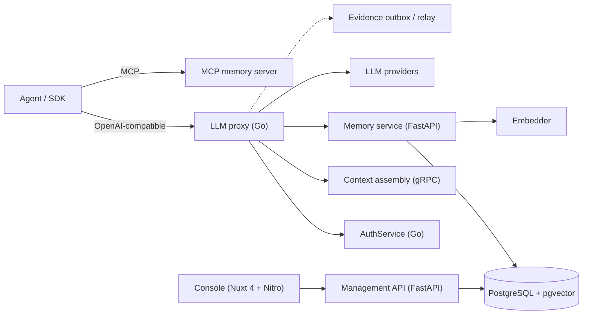
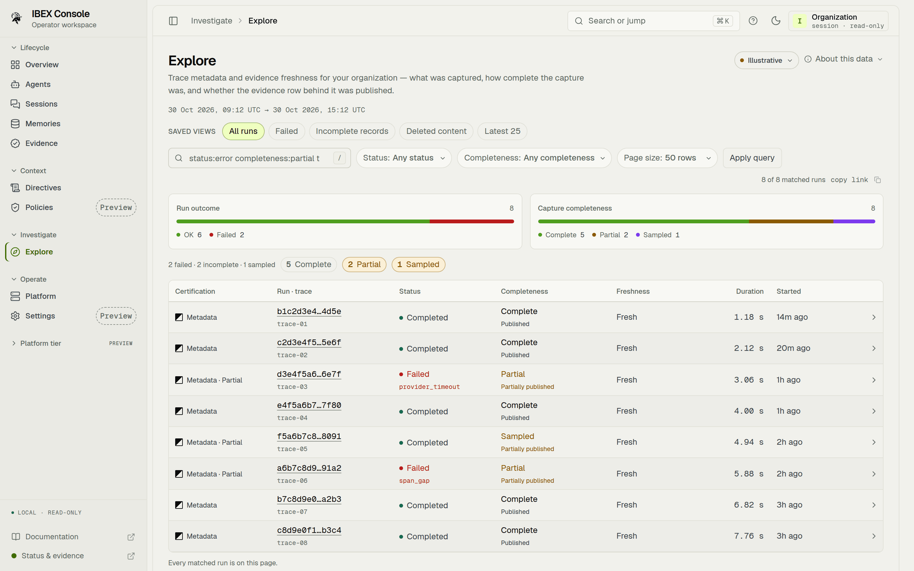
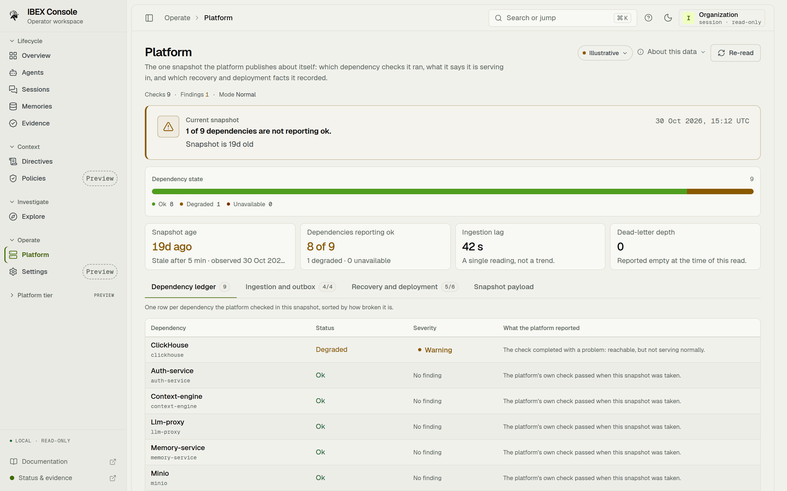
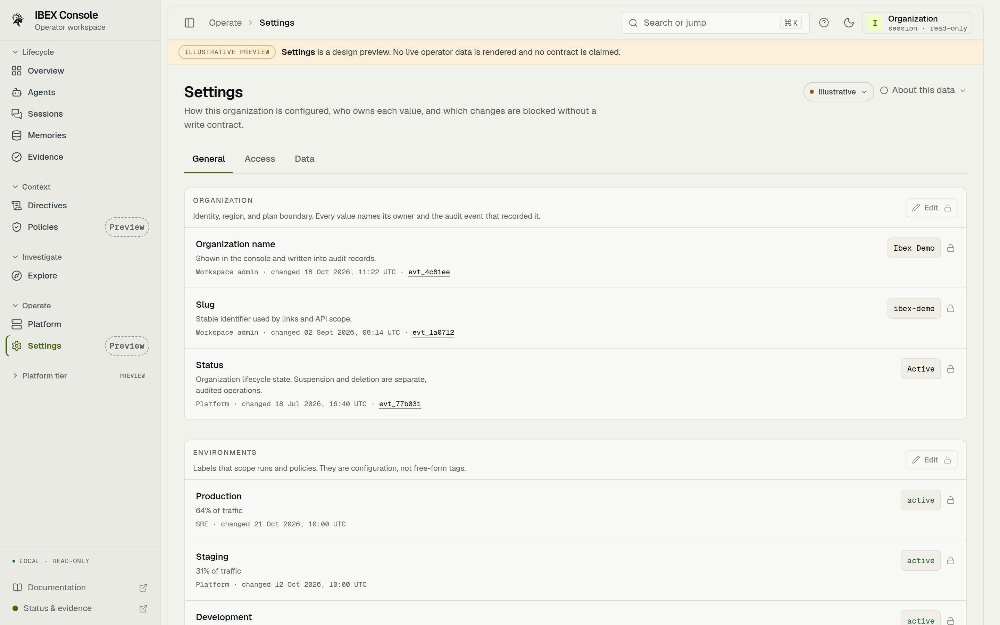

<p align="center">
  <picture>
    <source media="(prefers-color-scheme: dark)" srcset="site/public/brand/ibex-mark-dark.png">
    
  </picture>
</p>

<h1 align="center">IBEX Harness</h1>

<p align="center"><strong>Self-hosted memory and context for multi-tenant AI agents.</strong></p>



*The Console Overview, captured from a development build in demo mode. Every value is an illustrative fixture marked
by the `Illustrative` chip; it is not live operator data (ADR-0089 §4).*

<p align="center">
  Point your agent at an OpenAI-compatible endpoint or add the MCP server, and IBEX resolves tenant and agent identity,
  injects bounded context, stores governed memories, and attempts best-effort post-response evidence for governed
  sessions when the PostgreSQL evidence plane is configured.
</p>

<p align="center">
  <a href="README.md">English</a> ·
  <a href="README.es.md">Español</a> ·
  <a href="README.fr.md">Français</a> ·
  <a href="README.de.md">Deutsch</a> ·
  <a href="README.pt-BR.md">Português (Brasil)</a> ·
  <a href="README.zh-CN.md">中文</a> ·
  <a href="README.ar.md">العربية</a>
</p>

<p align="center">
  <a href="https://ibexharness.com">Website</a> ·
  <a href="https://ibexharness.com/docs">Docs</a> ·
  <a href="https://ibexharness.com/docs/architecture/status-and-evidence">Status</a> ·
  <a href="https://ibexharness.com/benchmarks">Benchmarks</a> ·
  <a href="engineering/DEVELOPMENT_GUIDE.md">Developer guide</a> ·
  <a href="engineering/SECURITY.md">Security</a>
</p>

<p align="center">
  <a href="https://github.com/Rick1330/ibex-harness/actions/workflows/ci.yml"></a>
  <a href="https://codecov.io/gh/Rick1330/ibex-harness"></a>
  <a href="https://scorecard.dev/viewer/?uri=github.com/Rick1330/ibex-harness&platform=github.com"></a>
  <a href="https://www.bestpractices.dev/projects/13590"></a>
  <a href="LICENSE"></a>
</p>

## Why IBEX

Most agent stacks treat memory as a vector database and identity as an afterthought. IBEX treats both as governed,
tenant-scoped infrastructure.

- **Identity on every call.** No `org_id` is accepted from a URL or browser. AuthService is the authority, and every
  data path filters explicitly.
- **Bounded context, not a prompt dump.** Retrieval, ranking, and packing run under a token budget and a deadline, and
  degrade to directive-only context rather than blocking the proxy.
- **Evidence after the response, deliberately best-effort.** Governed requests attempt an evidence outbox write once
  the response is sent. The guarantee has a stated boundary; see [Status and evidence](#status-and-evidence).

## How it fits together



The proxy is the adoption surface. Memory, context assembly, and the evidence model are the reason to keep it.

## Quick start

The supported deployment is the `v1-single-node` profile from [ADR-0097](engineering/adr/0097-v1-supported-profile.md):
one self-hosted Docker Compose project, no hosted offering and no HA topology. Prerequisites are Docker Compose v2 or
Podman Compose, GNU Make, and the versions in [`infra/tool-versions.conf`](infra/tool-versions.conf); see
[TOOLCHAIN.md](engineering/TOOLCHAIN.md).

```bash
git clone https://github.com/Rick1330/ibex-harness.git
cd ibex-harness
make setup
make check-tools
```

Generate the profile's secrets, start it, retrieve the one-time admin token, and prove it with an authenticated
request:

```bash
make v1-secrets
make v1-up
make v1-bootstrap-pat   # print the one-time bootstrap PAT, then store it and delete the file
make v1-smoke
```

`make v1-up` rebuilds the images, waits for every required service, and prints the URL. The first start downloads
roughly 2.3 GB of embedding weights and may take up to two hours; a warm `tei-cache` volume is the recommended pre-seed
for an offline or bandwidth-limited install. `make v1-down` stops the profile without deleting volumes.

For a restricted sandbox or Podman machine:

```bash
IBEX_RUNTIME=podman IBEX_NETWORK=host make setup
```

`make env-doctor` diagnoses runtime, port, DNS, and telemetry issues.

### Contributor path

The development stack is for working on the code, not for running the supported profile:

```bash
make compose-dev-up
make db-migrate
make db-seed
```

Start AuthService and the proxy in two terminals using the commands in
[`DEVELOPMENT_GUIDE.md` §4.4](engineering/DEVELOPMENT_GUIDE.md#44-run-services), then run the smoke test:

```bash
make dev-smoke
```

`make db-seed` is local-development only; never run it against a shared environment.

### Run the Console

```bash
pnpm install --frozen-lockfile --ignore-scripts
pnpm --filter @ibex/console dev
```

Open `http://127.0.0.1:3000`. Without an operator API origin the Console fails closed on live surfaces; a development
build also offers labelled illustrative fixtures (see [Console](#console)).

## Core concepts

| Concept | Meaning |
| --- | --- |
| **Organization** | The tenant boundary. Every row, cache key, and event carries its `org_id`. |
| **Agent** | A named principal with credentials, permissions, and a memory scope. |
| **Session** | A conversation or run context that groups turns and traces. |
| **Memory** | A governed record with provenance, confidence, lifecycle state, and optional PII redaction. |
| **Directive** | Standing context injected on every request, versioned separately from memories. |
| **Evidence** | Best-effort post-response trace and capture facts; rows may be withheld or lost on failure. |

## Services

| Service | Runtime | Status |
| --- | --- | --- |
| [`proxy/`](services/proxy/README.md) | Go | Local; hosted SLO open |
| [`auth/`](services/auth/README.md) | Go | Local; production key management gated |
| [`memory/`](services/memory/README.md) | Python / FastAPI | Local |
| [`context/`](services/context/README.md) | Python / gRPC | Provisional; caller boundary explicit |
| [`embedder/`](services/embedder/README.md) | Python | Profile-dependent |
| [`api/`](services/api/README.md) | Python / FastAPI | Mounted, tested; operator surfaces provisional |
| [`worker/`](services/worker/README.md) | Python / Celery | Mixed; some no-op tasks |
| [`mcp-memory/`](services/mcp-memory/README.md) | Python | Partial; logging-only audit |
| [`mcp-operator/`](services/mcp-operator/README.md) | Python | Local, default-off |
| [`relay/`](services/relay/README.md) | Go | Local, default-off; no production sink |
| [`console/`](services/console/README.md) | Nuxt 4 + Nitro | Provisional; 8 of 10 core reads live |

Status is a phrase here; the evidence and the boundary are behind each service link. The full inventory, shared
packages, and local infrastructure are in [`services/README.md`](services/README.md),
[`packages/README.md`](packages/README.md), and [`infra/README.md`](infra/README.md).

## Console

The Console is the operations plane for the memory/context lifecycle: Overview, Agents, Sessions, Memories, Evidence,
Directives, Policies, Explore, Platform, and Settings. Incidents, drift, audit, analytics, budgets, providers, MCP
tools, and access are an explicit platform tier behind a collapsed disclosure ([ADR-0089](engineering/adr/0089-product-shape-and-console-scope.md)).

It has a session. `/login` exchanges a personal access token once for an HttpOnly cookie, and
`server/api/operator/session/{login,logout,refresh}` are the only routes that mutate cookies. Every operator **data**
route is still a read: the Console exposes no data mutations. Eight of the ten core surfaces have a live read path;
Policies and Settings remain labelled previews.

A `Live` surface means its read path is connected and fails closed; it is not an acceptance claim. Every Console row
remains provisional in the status ledger. See [`services/console/README.md`](services/console/README.md).



*Explore: trace metadata and capture completeness. Illustrative fixtures under the `Illustrative` chip, not live
operator data (ADR-0089 §4).*



*Platform: dependency, ingestion, and recovery health. Illustrative fixtures under the `Illustrative` chip, not live
operator data (ADR-0089 §4).*



*Settings: a labelled `Illustrative preview`. No live operator data is rendered and no contract is claimed
(ADR-0089 §4).*

These captures come from a development build in demo mode. In a live deployment the same live surfaces render from the
operator API, and preview surfaces stay labelled previews.

## Documentation

- [Architecture](engineering/ARCHITECTURE.md)
- [Development guide](engineering/DEVELOPMENT_GUIDE.md)
- [API documentation](engineering/API_DOCUMENTATION.md)
- [Environment variables](engineering/ENVIRONMENT_VARIABLES.md)
- [Testing strategy](engineering/TESTING_STRATEGY.md)
- [Architecture decision records](engineering/adr/index.md)
- [Security](engineering/SECURITY.md)
- [Contributing](CONTRIBUTING.md)

## Development

```bash
make check                  # fast repository gate
make test-memory            # Python memory unit tests
make test-worker            # Python worker unit tests
make lint-go                # Go lint for auth, proxy, and packages
pnpm --filter @ibex/console test
pnpm --filter @ibex/console typecheck
pnpm --filter @ibex/console lint
pnpm site:build && pnpm site:check
```

The full local matrix, including integration tests with PostgreSQL, Redis, and ClickHouse, is in
[`engineering/agent-playbook.md`](engineering/agent-playbook.md) §6 and
[`engineering/DEVELOPMENT_GUIDE.md`](engineering/DEVELOPMENT_GUIDE.md) §4.4.

## Security and tenancy

- Tenant isolation is defense in depth: PostgreSQL RLS plus explicit `org_id` filtering on every query. Redis keys are
  namespaced by `org_id`; ClickHouse queries require an explicit `org_id` and refuse to run without one.
- Cross-tenant reads return `404`, not `403`, to avoid existence leaks.
- Secrets never reach logs, traces, browser configuration, or fixture data.
- Memory content is untrusted input: it is quarantined, delimited as data, and never treated as instructions.
- Report vulnerabilities through the private process in [`engineering/SECURITY.md`](engineering/SECURITY.md), not a
  public issue.

## Status and evidence

IBEX distinguishes **shipped**, **mounted-but-provisional**, **specified-not-implemented**, and **deferred**. Local
routes, schemas, fixtures, and design documents are not deployment evidence.

The authoritative runtime claim is the [status ledger](https://ibexharness.com/docs/architecture/status-and-evidence).
Do not infer hosted readiness, measured SLOs, HA, or restore evidence from this README.

**Evidence is best-effort, by design.** When the PostgreSQL evidence plane is configured and the session's
authoritative evidence-fence version is available, governed chat-completion requests attempt an evidence outbox write
after the response; the session does not need to be closed first. Evidence may be withheld when the session or its
fence is missing, or lost when persistence fails, the bounded queue is saturated, or the process shuts down before
draining. The relay is default-off, so this is not a synchronous durable-before-ack guarantee.

**The supported profile has been proven, not accepted.** On 2026-11-15 all 13 health-checked `v1-single-node`
containers came up healthy, no application connection used the owner login, and a route-level cross-tenant request was
refused. That is a live cross-tenant read plus the integration suites — not a full acceptance suite, and not a
two-tenant browser journey.

## Contributing

Read [`CONTRIBUTING.md`](CONTRIBUTING.md) and [`AGENTS.md`](AGENTS.md). Every commit needs a DCO sign-off
(`git commit -s`), and every pull request must link a tracking issue. Conventional Commits are enforced by CI.

## License

[MIT](LICENSE)
