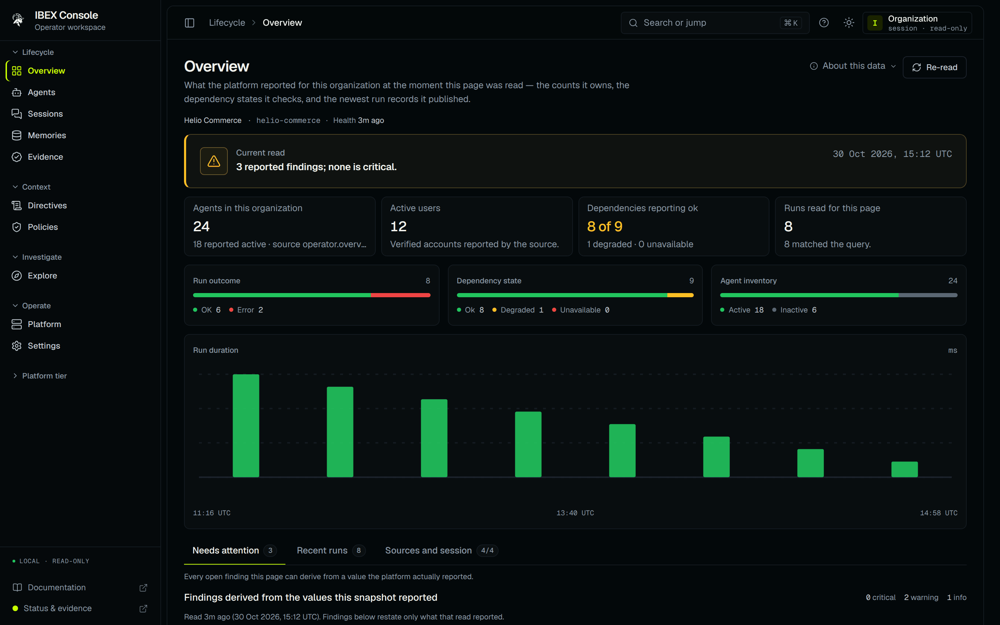
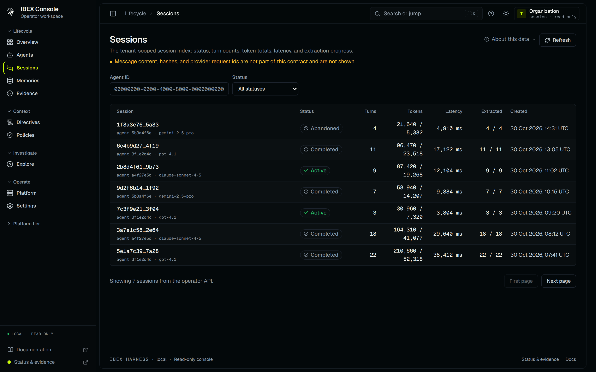
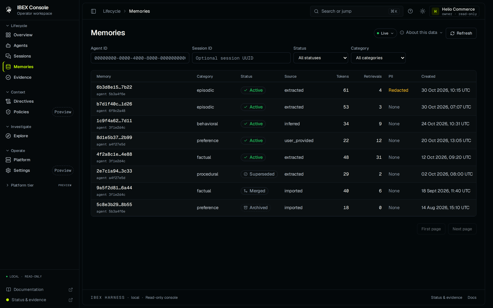
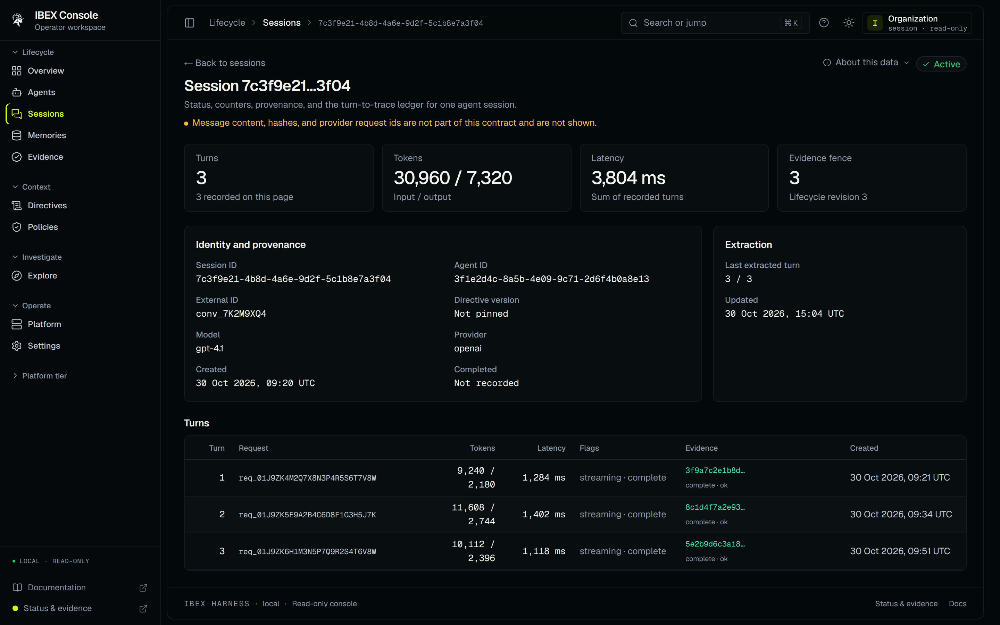

<p align="center">
  <picture>
    <source media="(prefers-color-scheme: dark)" srcset="site/public/brand/ibex-mark-dark.png">
    
  </picture>
</p>

<h1 align="center">IBEX Harness</h1>

<p align="center"><strong>Self-hosted memory and context for multi-tenant AI agents.</strong></p>

<p align="center">
  Point your agent at an OpenAI-compatible endpoint or add the MCP server, and IBEX resolves tenant and agent identity,
  injects bounded context, stores governed memories, and attempts best-effort post-response evidence for governed
  sessions when the PostgreSQL evidence plane is configured.
</p>

<p align="center">
  <a href="README.md">English</a> ·
  <a href="README.es.md">Español</a> ·
  <a href="README.fr.md">Français</a> ·
  <a href="README.de.md">Deutsch</a> ·
  <a href="README.pt-BR.md">Português (Brasil)</a> ·
  <a href="README.zh-CN.md">中文</a> ·
  <a href="README.ar.md">العربية</a>
</p>

<p align="center">
  <a href="https://ibexharness.com">Website</a> ·
  <a href="https://ibexharness.com/docs">Docs</a> ·
  <a href="https://ibexharness.com/docs/architecture/status-and-evidence">Status</a> ·
  <a href="https://ibexharness.com/benchmarks">Benchmarks</a> ·
  <a href="engineering/DEVELOPMENT_GUIDE.md">Developer guide</a> ·
  <a href="engineering/SECURITY.md">Security</a>
</p>

<p align="center">
  <a href="https://github.com/Rick1330/ibex-harness/actions/workflows/ci.yml"></a>
  <a href="https://codecov.io/gh/Rick1330/ibex-harness"></a>
  <a href="https://scorecard.dev/viewer/?uri=github.com/Rick1330/ibex-harness&platform=github.com"></a>
  <a href="https://www.bestpractices.dev/projects/13590"></a>
  <a href="LICENSE"></a>
</p>

## Why IBEX

Most agent stacks treat memory as a vector database and identity as an afterthought. IBEX treats both as governed,
tenant-scoped infrastructure.

- **Identity on every call.** No `org_id` is accepted from a URL or browser. AuthService is the authority, and every
  data path filters explicitly.
- **Bounded context, not a prompt dump.** Retrieval, ranking, and packing run under a token budget and a deadline, and
  degrade to directive-only context rather than blocking the proxy.
- **Evidence after the response, deliberately best-effort.** Governed requests attempt an evidence outbox write once
  the response is sent. The guarantee has a stated boundary; see [Status and evidence](#status-and-evidence).

|  |  |
| :---: | :---: |
| <br>Overview | <br>Sessions |
| <br>Memories | <br>Session detail |

## Quick start

The supported deployment is the `v1-single-node` profile from [ADR-0097](engineering/adr/0097-v1-supported-profile.md):
one self-hosted Docker Compose project, no hosted offering and no HA topology. Prerequisites are Docker Compose v2 or
Podman Compose, GNU Make, and the versions in [`infra/tool-versions.conf`](infra/tool-versions.conf); see
[TOOLCHAIN.md](engineering/TOOLCHAIN.md).

```bash
git clone https://github.com/Rick1330/ibex-harness.git
cd ibex-harness
make setup
make check-tools
```

Generate the profile's secrets, start it, retrieve the one-time admin token, and prove it with an authenticated
request:

```bash
make v1-secrets
make v1-up
make v1-bootstrap-pat   # print the one-time bootstrap PAT
make v1-smoke           # prove the profile with that PAT
```

Store the bootstrap PAT in your secret manager and remove
`infra/compose/v1-single-node/bootstrap/bootstrap.pat` **after** the smoke passes. The order matters: `make v1-smoke`
reads that file to authenticate, and a run without it exits 4 (skip), which the target treats as a failure — so deleting
the file first leaves the install unproven.

`make v1-up` rebuilds the images, waits for every required service, and prints the URL. The first start pulls the
embedding model into the `tei-cache` volume; pre-seed that volume for an offline or bandwidth-limited install.
`make v1-down` stops the profile without deleting volumes.

For a restricted sandbox or Podman machine, export the runtime so every later command sees it:

```bash
export IBEX_RUNTIME=podman
IBEX_NETWORK=host make setup   # development-stack overlay; v1-single-node rejects host networking
```

The scripts read `IBEX_RUNTIME` per process and default it to `auto`, which prefers Docker whenever `docker info`
succeeds (`infra/scripts/dev-tool.sh`). On a host that runs both, prefixing a single command would leave `make v1-up`
and `make v1-smoke` building and proving the profile on Docker, so export it once per shell instead. Leave
`IBEX_NETWORK` out of the shell environment: `v1-single-node` refuses `host` and exits 2, and the switch means something
only to the development stack.

`make env-doctor` diagnoses runtime, port, DNS, and telemetry issues.

### Contributor path

The development stack is for working on the code, not for running the supported profile:

```bash
make compose-dev-up
make db-migrate
make db-seed
```

Start AuthService and the proxy in two terminals using the commands in
[`DEVELOPMENT_GUIDE.md` §4.4](engineering/DEVELOPMENT_GUIDE.md#44-run-services), then run the smoke test:

```bash
make dev-smoke
```

`make db-seed` is local-development only; never run it against a shared environment.

### Run the Console

```bash
pnpm install --frozen-lockfile --ignore-scripts
pnpm --filter @ibex/console dev
```

Open `http://127.0.0.1:3000`. Without an operator API origin the Console fails closed rather than rendering fixtures.

## Services

| Service | Runtime | What it does | Status |
| --- | --- | --- | --- |
| [`auth/`](services/auth/README.md) | Go | Token and agent validation, PAT lifecycle, provider-credential metadata | Local |
| [`proxy/`](services/proxy/README.md) | Go | OpenAI-compatible LLM proxy: auth, rate limits, context injection, streaming | Local |
| [`memory/`](services/memory/README.md) | Python / FastAPI | Tenant-scoped memory writes, semantic search, dedup, conflicts, PII | Local |
| [`context/`](services/context/README.md) | Python / gRPC | Budgeted retrieval, ranking, and packing behind a caller-token boundary | Provisional |
| [`embedder/`](services/embedder/README.md) | Python | Embedding contract and backend selection | Profile-dependent |
| [`api/`](services/api/README.md) | Python / FastAPI | Management plane: tenants, tokens, providers, policies, operator reads | Provisional |
| [`worker/`](services/worker/README.md) | Python / Celery | Extraction, erasure, billing rollups, maintenance | Mixed |
| [`mcp-memory/`](services/mcp-memory/README.md) | Python | MCP memory tools over Streamable HTTP | Partial |
| [`mcp-operator/`](services/mcp-operator/README.md) | Python | Read-only operator MCP tools | Default-off |
| [`relay/`](services/relay/README.md) | Go | Evidence outbox relay daemon | Default-off |
| [`console/`](services/console/README.md) | Nuxt 4 + Nitro | Operator application and its server-only BFF | Provisional |

Status is a one-word signal; the [status ledger](https://ibexharness.com/docs/architecture/status-and-evidence) carries
the evidence, the boundary, and the open gaps. The full inventory, shared packages, and local infrastructure are in
[`services/README.md`](services/README.md), [`packages/README.md`](packages/README.md), and
[`infra/README.md`](infra/README.md).

## Console

The Console is the canonical operator application: a Nuxt 4 server-rendered app with a server-only BFF, covering the
memory/context lifecycle — agents, sessions, memories, evidence, directives, policies, trace exploration, platform
health, and settings. Incidents, drift, audit, analytics, budgets, providers, MCP tools, and access are a separate
platform tier ([ADR-0089](engineering/adr/0089-product-shape-and-console-scope.md)).

It is read-only by design: `/login` exchanges a personal access token once for an HttpOnly cookie, and the Console
exposes no data mutations. Which surfaces have a live read path, and which are labelled previews, is owned by the
surface registry in [`services/console/shared/operator/surfaces.ts`](services/console/shared/operator/surfaces.ts);
this README does not restate it. See [`services/console/README.md`](services/console/README.md).

## Security and tenancy

Tenant isolation is defense in depth: PostgreSQL RLS plus explicit `org_id` filtering on every query, with Redis keys
namespaced by `org_id`. Cross-tenant reads return `404`, not `403`, to avoid existence leaks.

Report vulnerabilities through the private process in [`engineering/SECURITY.md`](engineering/SECURITY.md), not a
public issue.

## Status and evidence

IBEX distinguishes **shipped**, **mounted-but-provisional**, **specified-not-implemented**, and **deferred**. Local
routes, schemas, fixtures, and design documents are not deployment evidence.

The authoritative runtime claim is the [status ledger](https://ibexharness.com/docs/architecture/status-and-evidence).
Do not infer hosted readiness, measured SLOs, HA, or restore evidence from this README.

**Evidence is best-effort, by design.** When the PostgreSQL evidence plane is configured and the session's
authoritative evidence-fence version is available, governed chat-completion requests attempt an evidence outbox write
after the response; the session does not need to be closed first. Evidence may be withheld when the session or its
fence is missing, or lost when persistence fails, the bounded queue is saturated, or the process shuts down before
draining. The relay is default-off, so this is not a synchronous durable-before-ack guarantee.

**The supported profile has been proven, not accepted.** On 2026-11-15 all 13 health-checked `v1-single-node`
containers came up healthy, no application connection used the owner login, and a route-level cross-tenant request was
refused. That is a live cross-tenant read plus the integration suites — not a full acceptance suite, and not a
two-tenant browser journey.

## Documentation

- [Architecture](engineering/ARCHITECTURE.md)
- [Development guide](engineering/DEVELOPMENT_GUIDE.md)
- [API documentation](engineering/API_DOCUMENTATION.md)
- [Environment variables](engineering/ENVIRONMENT_VARIABLES.md)
- [Testing strategy](engineering/TESTING_STRATEGY.md)
- [Architecture decision records](engineering/adr/index.md)
- [Security](engineering/SECURITY.md)
- [Contributing](CONTRIBUTING.md)

## Contributing

Read [`CONTRIBUTING.md`](CONTRIBUTING.md) and [`AGENTS.md`](AGENTS.md). Every commit needs a DCO sign-off
(`git commit -s`), and every pull request must link a tracking issue. Conventional Commits are enforced by CI.

## License

[MIT](LICENSE)
