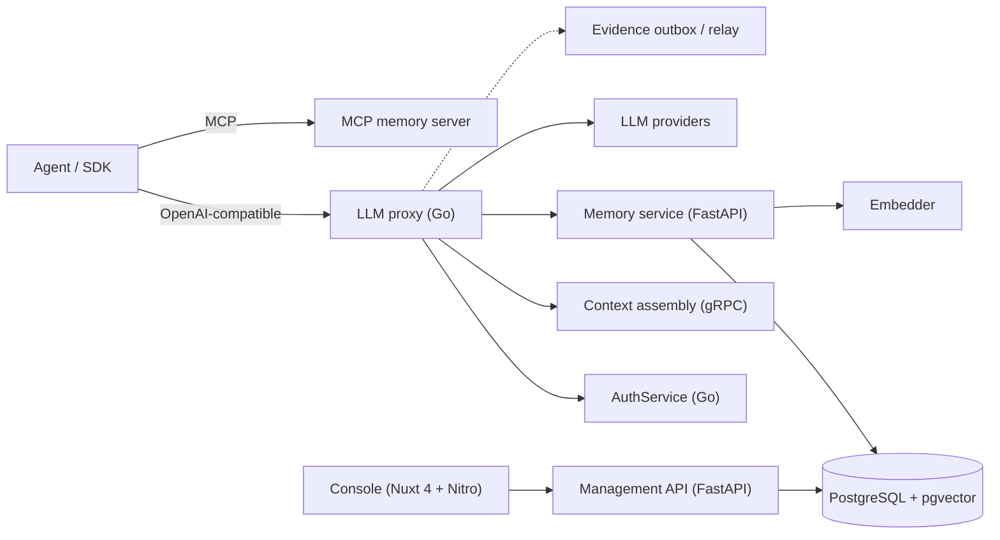

<p align="center">
  <picture>
    <source media="(prefers-color-scheme: dark)" srcset="site/public/brand/ibex-mark-dark.png">
    
  </picture>
</p>

<h1 align="center">IBEX Harness</h1>

<p align="center"><strong>Self-hosted memory and context for multi-tenant AI agents.</strong></p>

<p align="center">
  Point your agent at an OpenAI-compatible endpoint or add the MCP server. IBEX resolves tenant and agent identity,
  injects bounded context, stores governed memories, and attaches evidence to every request.
</p>

<p align="center">
  <a href="README.md">English</a> ·
  <a href="README.es.md">Español</a> ·
  <a href="README.fr.md">Français</a> ·
  <a href="README.de.md">Deutsch</a> ·
  <a href="README.pt-BR.md">Português (Brasil)</a> ·
  <a href="README.zh-CN.md">中文</a> ·
  <a href="README.ar.md">العربية</a>
</p>

<p align="center">
  <a href="https://ibexharness.com">Website</a> ·
  <a href="https://ibexharness.com/docs">Docs</a> ·
  <a href="https://ibexharness.com/docs/architecture/status-and-evidence">Status</a> ·
  <a href="https://ibexharness.com/benchmarks">Benchmarks</a> ·
  <a href="engineering/DEVELOPMENT_GUIDE.md">Developer guide</a> ·
  <a href="engineering/SECURITY.md">Security</a>
</p>

<p align="center">
  <a href="https://github.com/Rick1330/ibex-harness/actions/workflows/ci.yml"></a>
  <a href="https://codecov.io/gh/Rick1330/ibex-harness"></a>
  <a href="https://scorecard.dev/viewer/?uri=github.com/Rick1330/ibex-harness&platform=github.com"></a>
  <a href="https://www.bestpractices.dev/projects/13590"></a>
  <a href="LICENSE"></a>
</p>

## Why IBEX

Most agent stacks treat memory as a vector database and identity as an afterthought. IBEX treats both as governed,
tenant-scoped infrastructure:

- **Tenant and agent identity on every call.** No `org_id` is ever accepted from a URL or browser; AuthService is the
  authority and every data path filters explicitly.
- **Bounded context, not a prompt dump.** Context assembly retrieves, ranks, and packs memories and directives within a
  token budget and a deadline, and degrades to directive-only context rather than blocking the proxy.
- **Evidence attached to the request.** Traces, redaction state, capture mode, and publication state travel with the
  run, so an operator can answer "what happened?" without reconstructing it from logs.

## How it fits together



The proxy is the adoption surface. Memory, context assembly, and the evidence model are the reason to keep it.

## Quick start

Prerequisites: Docker Compose v2 or Podman Compose, GNU Make, and the versions in
[`infra/tool-versions.conf`](infra/tool-versions.conf). See [TOOLCHAIN.md](engineering/TOOLCHAIN.md).

```bash
git clone https://github.com/Rick1330/ibex-harness.git
cd ibex-harness
make setup
make check-tools
```

Start the local dependencies, apply migrations, and seed a development tenant:

```bash
make compose-dev-up
make db-migrate
make db-seed
```

Start AuthService and the proxy in two terminals using the commands in
[`DEVELOPMENT_GUIDE.md` §4.4](engineering/DEVELOPMENT_GUIDE.md#44-run-services), then run the smoke test:

```bash
make dev-smoke
```

For a restricted sandbox or Podman machine:

```bash
IBEX_RUNTIME=podman IBEX_NETWORK=host make setup
```

`make env-doctor` diagnoses runtime, port, DNS, and telemetry issues. `make db-seed` is local-development only; never
run it against a shared environment.

Run the Console:

```bash
pnpm install --frozen-lockfile --ignore-scripts
pnpm --filter @ibex/console dev
```

Open `http://127.0.0.1:3000`. The Console is read-only and fails closed without an operator session and
`IBEX_OPERATOR_API_ORIGIN`.

## Core concepts

| Concept | Meaning |
| --- | --- |
| **Organization** | The tenant boundary. Every row, cache key, and event carries its `org_id`. |
| **Agent** | A named principal with credentials, permissions, and a memory scope. |
| **Session** | A conversation or run context that groups turns and traces. |
| **Memory** | A governed record with provenance, confidence, lifecycle state, and optional PII redaction. |
| **Directive** | Standing context injected on every request, versioned separately from memories. |
| **Evidence** | Trace, capture, redaction, and publication facts attached to a request. |

## Services

| Service | Runtime | Status |
| --- | --- | --- |
| [`proxy/`](services/proxy/README.md) | Go | Shipped locally; hosted SLO evidence open |
| [`auth/`](services/auth/README.md) | Go | Shipped locally; production key management gated |
| [`memory/`](services/memory/README.md) | Python / FastAPI | Shipped locally |
| [`context/`](services/context/README.md) | Python / gRPC | Provisional; trusted-boundary caller limitation is explicit |
| [`embedder/`](services/embedder/README.md) | Python | Shipped or experimental by profile |
| [`api/`](services/api/README.md) | Python / FastAPI | Mounted and tested; operator surfaces provisional |
| [`worker/`](services/worker/README.md) | Python / Celery | Mixed; some task families are explicit no-ops |
| [`mcp-memory/`](services/mcp-memory/README.md) | Python | Shipped/partial; logging-only audit by default |
| [`mcp-operator/`](services/mcp-operator/README.md) | Python | Shipped locally, default-off |
| [`relay/`](services/relay/README.md) | Go | Implemented locally, default-off; no production sink |
| [`console/`](services/console/README.md) | Nuxt 4 + Nitro | Provisional; 6 of 10 core surfaces have a live read path |

The full inventory, shared packages, and local infrastructure are in [`services/README.md`](services/README.md),
[`packages/README.md`](packages/README.md), and [`infra/README.md`](infra/README.md).

## Console

The Console is the operations plane for the memory/context lifecycle: Overview, Agents, Sessions, Memories, Evidence,
Directives, Policies, Explore, Platform, and Settings. Incidents, drift, analytics, budgets, providers, MCP tools, and
access are an explicit platform tier behind a collapsed disclosure (ADR-0089).

A `Live` surface means its read path is connected and fails closed; it is not an acceptance claim. Every Console row
remains provisional in the status ledger. See [`services/console/README.md`](services/console/README.md).

## Documentation

- [Architecture](engineering/ARCHITECTURE.md)
- [Development guide](engineering/DEVELOPMENT_GUIDE.md)
- [API documentation](engineering/API_DOCUMENTATION.md)
- [Environment variables](engineering/ENVIRONMENT_VARIABLES.md)
- [Testing strategy](engineering/TESTING_STRATEGY.md)
- [Architecture decision records](engineering/adr/index.md)
- [Security](engineering/SECURITY.md)
- [Contributing](CONTRIBUTING.md)

## Development

```bash
make check                  # fast repository gate
make test-memory            # Python memory unit tests
make test-worker            # Python worker unit tests
make lint-go                # Go lint for auth, proxy, and packages
pnpm --filter @ibex/console test
pnpm --filter @ibex/console typecheck
pnpm --filter @ibex/console lint
pnpm site:build && pnpm site:check
```

The full local matrix, including integration tests with PostgreSQL, Redis, and ClickHouse, is in
[`engineering/agent-playbook.md`](engineering/agent-playbook.md) §6 and
[`engineering/DEVELOPMENT_GUIDE.md`](engineering/DEVELOPMENT_GUIDE.md) §4.4.

## Security and tenancy

- Tenant isolation is defense in depth: PostgreSQL RLS plus explicit `org_id` filtering on every query. Redis keys are
  namespaced by `org_id`; ClickHouse queries require an explicit `org_id` and refuse to run without one.
- Cross-tenant reads return `404`, not `403`, to avoid existence leaks.
- Secrets never reach logs, traces, browser configuration, or fixture data.
- Memory content is untrusted input: it is quarantined, delimited as data, and never treated as instructions.
- Report vulnerabilities through the private process in [`engineering/SECURITY.md`](engineering/SECURITY.md), not a
  public issue.

## Status and evidence

IBEX distinguishes **shipped**, **mounted-but-provisional**, **specified-not-implemented**, and **deferred**. Local
routes, schemas, fixtures, and design documents are not deployment evidence.

The authoritative runtime claim is the [status ledger](https://ibexharness.com/docs/architecture/status-and-evidence).
Do not infer hosted readiness, measured SLOs, HA, or restore evidence from this README.

## Contributing

Read [`CONTRIBUTING.md`](CONTRIBUTING.md) and [`AGENTS.md`](AGENTS.md). Every commit needs a DCO sign-off
(`git commit -s`), and every pull request must link a tracking issue. Conventional Commits are enforced by CI.

## License

[MIT](LICENSE)
