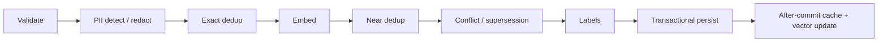

A memory system that only inserts rows is a log with a search box. The hard part is deciding what should become memory, what should replace something older, what should be quarantined, and what should never be written twice.

That decision process is the write path. At IBEX Harness it is an ordered pipeline: validate, redact, deduplicate, embed, detect conflict, label, persist, then update caches and indexes after the transaction commits. Each stage has a narrow job and a deliberate failure mode.

The pipeline is implemented and locally evidenced. It is not a claim that every derived copy is deletion-certified or that the lifecycle contract is finished. Those boundaries matter, so they are stated alongside the design.

## The sequence

The ordering is not arbitrary. Redaction happens before hashing because the same content with an email address should not produce two different dedup identities. Embedding happens after redaction because the vector should represent the content the system is allowed to store. Persistence happens after conflict resolution because a write may update relationships as well as insert a row.

## Validate before doing anything expensive

The request must carry an organization and agent scope, bounded content, a source, and valid optional temporal fields. Labels are validated as a set: an explicit empty array is invalid, duplicates are rejected, and the maximum is five. Invalid input fails before embedding or database work.

Tenant and agent scope come from the authenticated principal. They are not accepted as free-form body fields that a caller can point at another organization.

## Redact first, then hash

Presidio runs a two-tier detect-and-redact pass. The default redaction confidence is `0.70`. High-confidence findings become typed placeholders such as `[EMAIL_ADDRESS]`. Low-confidence or disallowed findings can place the record in `quarantined` status.

Quarantined content is stored for review, but it is not ordinary active memory. It must not be injected as trusted context. “Stored” and “retrievable” are separate states, and the write path is where that distinction is created.

## Exact deduplication is a hash, not a model call

After redaction, the content is normalized and hashed with SHA-256. If an active row already has the same hash, the write is an exact duplicate. Retrieval metadata is bumped, embedding is skipped, and the duplicate is not persisted as a second active memory. A partial unique index protects the same invariant at the database level.

This is the cheapest and most reliable dedup stage. It also handles the most common case: a client retries the same request, or two sessions extract the same sentence verbatim.

## Near deduplication is a signal, not a verdict

The service embeds the redacted content and searches for a sufficiently similar existing memory. The default threshold is `0.92`, using a strict greater-than comparison. A match is reported as a near duplicate.

The wording matters. A near duplicate is not automatically “the same memory.” Two sentences can be close in embedding space while differing in a date, a scope, or a negation. The write path records the relationship and lets the conflict stage decide what it means rather than silently collapsing distinct knowledge.

## Conflict handling starts with intervals

Conflict detection is interval-overlap-first. If the new memory has the same subject, a newer `valid_from`, and a non-overlapping validity interval, it can produce a `supersedes` relationship without an LLM call. When intervals overlap or `valid_from` is missing, the service can call a pluggable classifier.

The relationship types are deliberately explicit:

| Relationship | Meaning |
| --- | --- |
| Contradiction | The new memory asserts the opposite of an existing active memory. |
| Overlap | Both memories cover substantially the same claim or period. |
| Supersedes | The new memory replaces an older claim going forward. |
| Specializes | The new memory refines a broader existing claim. |

Temporal validity is what keeps this from becoming a pile of contradictory facts. A memory can be true for a period and then stop being current without being deleted. User-facing reads are validity-fenced and return active, current memories by default. Internal conflict and dedup paths can request historical candidates through a capability that user reads do not get.

That separation is important. If normal search returned superseded memories, the agent would keep retrieving a fact that the system already knows is out of date. If conflict detection could only see current memories, it would lose the history it needs to decide whether a new claim supersedes an old one.

## Transaction first, effects after

The memory row, labels, and relationship changes are written in one transaction. After commit, the service updates the optional Redis hot cache and the vector index.

Cache and index updates are after-commit effects because they are derived state. A cache failure should not erase a durable memory; it should degrade read performance and emit telemetry. The database remains the source of truth.

The write path also records provenance and lifecycle columns so later stages can reason about where a memory came from and whether it has been superseded or forgotten.

## Idempotency is part of the contract

Clients can send `X-Idempotency-Key`. The ledger is scoped by `(org, agent, key)`, not just the key alone.

| Case | Result |
| --- | --- |
| Same key, same body | Replay the stored successful response. |
| Same key, different body | `409 IDEMPOTENCY_CONFLICT`. |
| Claim still active | `409 IDEMPOTENCY_IN_PROGRESS` with a retry hint. |
| PostgreSQL unavailable for a keyed write | `503 IDEMPOTENCY_UNAVAILABLE`. |
| Row committed but claim cannot finalize | `503`; do not report success over an unfinished claim. |

This is stricter than a best-effort dedup check. A retry is safe because the system can recognize the original attempt, not because the embedding happens to be similar.

## What the write path refuses to hide

The pipeline logs identifiers, stage outcomes, and timings. It does not log raw content, embeddings, or credentials. Diagnosis uses the memory ID and request ID.

Failures are explicit:

- An embedding failure is an error, not a reason to persist a half-written active record.
- A PII finding can quarantine the record rather than silently dropping it.
- A conflict classifier failure does not grant permission to overwrite history.
- A keyed write without a reachable ledger fails closed.
- A cache outage degrades reads but does not corrupt the durable record.

These choices trade availability for integrity at the write boundary. That is usually the right trade for memory: a delayed write can be retried, but a wrongly merged or wrongly scoped memory is much harder to unwind.

## The evidence boundary

The substrate and write pipeline are implemented locally. The current evidence includes unit and integration coverage for dedup, conflict candidates, temporal reads, PII handling, tenant scope, idempotency, and lifecycle revision fencing.

It does not include:

- A complete deletion guarantee across PostgreSQL, Redis, ClickHouse, and archives.
- Exactly-once projection effects across stores.
- A durable typed revision ledger with provenance checkpoints.
- Hosted/HA behavior or a measured write-latency SLO.

The forget route is the clearest example. It writes a revision-fenced tombstone, invalidates stale workers, removes the hot-cache entry after commit, and makes reads and dedup ignore the row. That is meaningful local behavior. It is not yet an accepted public deletion contract, because full-store deletion and restore semantics remain open.

## The lesson

Memory quality is not created at retrieval time. It is created when the system decides what to write, what to merge, what to supersede, and what to quarantine.

Treat the write path as a refinery. Make every stage observable, make every failure explicit, and never let “we stored it” stand in for “we know what it means.”

## Read next

- [Memory overview](/docs/memory/overview) — substrate, read path, and current limits.
- [Write path reference](/docs/memory/write-path) — validation, PII, dedup, conflict, and idempotency.
- [Search and lifecycle](/docs/memory/search-and-lifecycle) — temporal reads, ranking, and tombstones.
- [Put the proxy before the memory](/blog/proxy-before-memory) — the boundary that makes tenant-scoped retrieval possible.
