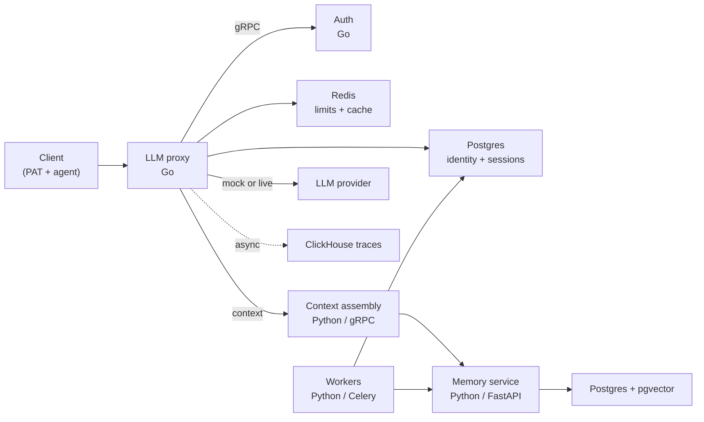

::page-status{status="IMPLEMENTED" verified="2026-10-22"}
::

IBEX Harness is a self-hosted platform for agent memory and context. It authenticates LLM traffic, resolves tenant and agent identity, injects context, stores memories, and exposes the traces and evidence needed to explain what happened.

The project has a working local stack and a deliberately narrow public claim: **implemented locally is not the same as production-ready**. Hosted HA, restore drills, end-to-end tenant-isolation proof, and a measured p99 SLO remain open.

## What works today

| Surface | Status | What that means |
| --- | --- | --- |
| Auth and proxy foundations | IMPLEMENTED | PAT and agent validation, tenant scope, rate limits, directives, sessions, idempotency, mock/live forwarding, async traces. |
| Memory substrate | IMPLEMENTED | PostgreSQL + pgvector storage, write orchestration, dedup, conflict candidates, hot cache, temporal reads. |
| Context assembly | PROVISIONAL | Budgeting, retrieval, ranking, packing, and formatting exist; caller authentication and deadline boundaries remain open. |
| Extraction workers | PROVISIONAL | Batch extraction and an evaluation harness exist; queue durability and exactly-once projection are not certified. |
| MCP memory tools | PROVISIONAL | Search, write, and feedback tools exist; audit is logging-first. |
| MCP operator gateway | IMPLEMENTED | Read-only metadata tools, default-off. PolicySnapshot resource evaluation is not wired. |
| Management API | IMPLEMENTED | Tenant, agent, token, provider, policy, rate-limit, billing, and usage routes exist locally. |
| Operator Console | PROVISIONAL | D1/D2 read slices exist; login, mutations, and hosted evidence remain open. |
| DecisionService, GLiNER | PROPOSED | Design intent only. No runtime, contract, benchmark, or acceptance evidence. |
| Graph, A2A, marketplace, sandbox | DEFERRED | Not current dependencies. Requires a separate gate and evidence. |

The authoritative version of this table is [Status and evidence](/docs/architecture/status-and-evidence).

## What is not claimed

- **No hosted SLO.** The p99 ≤20 ms proxy target is ratified, but there is no recent passing full-chat p99 run. The PR-time Go gate is mean-based.
- **No production certification.** Memory and context have local tests, including PostgreSQL-backed integration tests, but not hosted/HA or restore evidence.
- **No complete tenant-isolation proof.** Explicit `org_id` filtering and RLS exist. Full-store deletion, projection fencing, and independent review remain open.
- **No accepted typed memory lifecycle.** Historical conflict candidates and temporal reads are fenced; a durable revision ledger remains unimplemented.

## Start with the request path

The proxy is the critical path. Context retrieval must be bounded and must degrade to directive-only context rather than blocking inference. See [Architecture](/docs/architecture/overview) and [Request lifecycle](/docs/architecture/request-lifecycle).

## Choose a path

::card-group
::card
---
{"title":"Run it locally","to":"/docs/getting-started/quickstart","icon":"i-lucide-terminal"}
---
Compose, migrations, seed data, and a mock chat request.
::

::card
---
{"title":"Integrate the API","to":"/docs/api-reference/chat-completions","icon":"i-lucide-code"}
---
OpenAI-compatible chat completions and stable error envelopes.
::

::card
---
{"title":"Understand memory","to":"/docs/memory/overview","icon":"i-lucide-brain"}
---
Write path, dedup, conflict candidates, and retrieval boundaries.
::

::card
---
{"title":"Check evidence","to":"/docs/architecture/status-and-evidence","icon":"i-lucide-file-check"}
---
Claim rules, current baseline, and review dates.
::
::

## New contributor path

1. Install Docker, GNU Make, Go 1.25+, Python 3.12+, and Buf.
2. Run `make compose-dev-up`, `make db-migrate`, and `make db-seed`.
3. Run `make proto-gen` before Go tests that depend on generated protobufs.
4. Start auth before the proxy; protected routes depend on auth gRPC.
5. Run `make dev-smoke` for health, auth failures, and a mock completion.

Set `IBEX_AUTH_VALIDATE_TIMEOUT=2s` on local proxy runs. The production `50ms` validation budget is too tight for Argon2 verification on typical developer machines.
