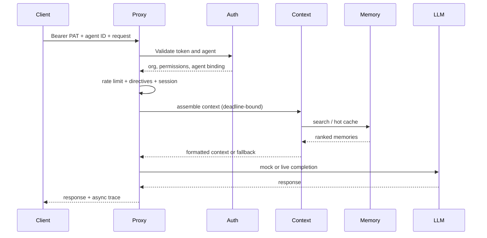

::page-status{status="IMPLEMENTED" verified="2026-10-21"}
::

IBEX Harness separates **who** is calling (organization + agent), **what** they may do (permissions), **what the platform remembers** (memory), and **what gets injected** (context). That separation is the core mental model.

## Platform vocabulary

| Term | Meaning | Status |
| --- | --- | --- |
| **Organization** | Top-level tenant; owns agents, tokens, memories, sessions, and limits. | IMPLEMENTED |
| **Agent** | Autonomous actor inside an org; bound to protected requests. | IMPLEMENTED |
| **PAT** | Personal access token, `ibex_pat_*`; hashed at rest with Argon2id. | IMPLEMENTED |
| **RLS** | PostgreSQL row-level security isolating tenant rows. | IMPLEMENTED |
| **Directive** | Org behavioral instruction injected into the prompt. | IMPLEMENTED |
| **Session** | Conversation lifecycle and turn checkpoints. | IMPLEMENTED |
| **Memory** | Persistent, tenant-scoped knowledge extracted from interactions. | IMPLEMENTED |
| **Context assembly** | Budgeted retrieval, ranking, packing, and formatting of context. | PROVISIONAL |
| **Hot cache** | Redis sorted-set cache of recently written memories. | IMPLEMENTED |
| **Evidence run** | Durable record used to explain a request or response. | PROVISIONAL |

## Identity and tenancy

1. **Organization** — every token, agent, session, memory, and trace belongs to exactly one `org_id`. Tenant scope comes from the verified token, never from an untrusted request field.
2. **Agent** — the proxy requires `X-IBEX-Agent-ID` on protected routes and verifies that the agent belongs to the token organization.
3. **Token (PAT)** — the proxy validates the bearer token through auth gRPC, optionally through a bloom + LRU cache. Permissions are a 64-bit bitmap ([ADR-0009](https://github.com/Rick1330/ibex-harness/blob/main/engineering/adr/0009-permission-bitmap.md)).
4. **User** — a human operator linked to org membership. Operator session flows exist in the Console but are provisional.

Defense in depth is mandatory: middleware checks, service-level checks, repository `org_id` predicates, and PostgreSQL RLS. A missing org context fails closed.

## Request path



Context retrieval is not allowed to make the proxy wait indefinitely. If retrieval or assembly fails, the request proceeds with directive-only context and the degradation is recorded.

## Memory model

A memory is a tenant- and agent-scoped record with content, category or labels, confidence, provenance metadata, timestamps, and embedding. The write path:

1. Validates tenant, agent, and PII policy.
2. Computes an embedding.
3. Runs near-duplicate detection.
4. Loads historical conflict candidates.
5. Persists the memory and links/conflict records in the same transaction.
6. Updates the hot cache.
7. Emits observability signals.

Reads are validity-fenced: the default user read returns current memories, while internal conflict logic can request historical candidates through an explicit capability. Typed lifecycle, revision-ledger, and deletion certification remain open under GAP-007.

## Context model

Context assembly turns a request plus retrieved memories into model-ready text:

```text
budget → parallel retrieval → composite ranking → relevance gate → packing → formatting → injection
```

The formatter serializes memory content as data with escaped delimiters and a per-assembly nonce. Memory content is never treated as instructions.

Current limitations:

- Caller authentication at the context boundary remains open.
- The deadline contract has a known discrepancy between configuration and caller behavior.
- Packing and formatting have local tests, not hosted or end-to-end SLO evidence.

See [Context assembly](/docs/context/overview) and [ADR-0071](https://github.com/Rick1330/ibex-harness/blob/main/engineering/adr/0071-context-grpc-degradation-deadline.md).

## Required headers

```text
Authorization: Bearer ibex_pat_<uuid>_<secret>
X-IBEX-Agent-ID: <agent-uuid>
Content-Type: application/json
```

Optional: `Idempotency-Key` on supported non-streaming mutations and `X-IBEX-Session-ID` for sticky sessions.

::callout
---
{"type":"tip","title":"Org comes from the token"}
---

  Chat uses `POST /v1/chat/completions` without an org in the path. Tenant scope comes from the PAT. Path-based org probes must match the token org.

::

## Errors and status

All JSON errors use a stable envelope with a machine-readable `code`, a human-readable `message`, and `request_id`. Use the request ID to correlate proxy, auth, memory, and trace logs.

Status vocabulary in these docs:

- **IMPLEMENTED** — implemented and locally evidenced.
- **PROVISIONAL** — a seam or contract exists; evidence, review, or a gate remains open.
- **PROPOSED** — design intent only.
- **DEFERRED** — intentionally outside the current dependency set.
- **UNKNOWN** — evidence is missing or expired.

Do not read these labels as hosted availability or production approval. The [status ledger](/docs/architecture/status-and-evidence) is authoritative.

## What is not available

- Graph traversal, A2A, marketplace, managed cloud, and a coding sandbox are deferred.
- DecisionService and GLiNER are proposed, with no runtime.
- A complete operator control plane is provisional.
- No hosted p99 SLO is published.

## Related guides

- [Introduction](/docs/getting-started/introduction) — capability boundary
- [Quickstart](/docs/getting-started/quickstart) — local setup
- [Memory](/docs/memory/overview) — storage and retrieval
- [Context assembly](/docs/context/overview) — budgeting and formatting
- [Security](/docs/security/overview) — isolation and fail-closed rules
- [Glossary](/docs/reference/glossary) — term definitions
