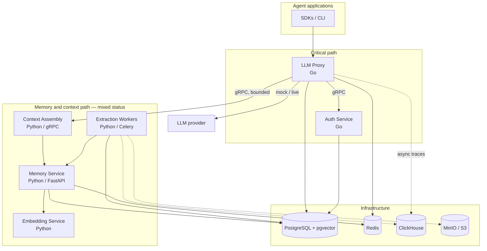

::page-status{status="PROVISIONAL" verified="2026-10-21" note="Go path implemented; Python services are provisional"}
::

IBEX Harness is split between a latency-critical Go request path and Python services for memory, context, and extraction. The split is deliberate: authentication and forwarding stay small and fast, while memory processing can fail or degrade without blocking inference.

## System diagram

## Critical path

Every LLM request follows the same shape:

1. Validate the bearer token and agent binding.
2. Enforce org and model limits.
3. Resolve directive and session.
4. Retrieve and assemble context within a bounded deadline when enabled.
5. Forward to the provider and return or stream the response.
6. Emit traces, checkpoints, and evidence asynchronously.

The proxy must not wait on analytics, extraction, or durable evidence writes. Context retrieval has a hard deadline and a directive-only fallback.

**Latency claims:** p99 ≤20 ms is a target. There is no recent passing full-chat p99 run, and the PR-time Go gate is mean-based. See [GAP-004](/docs/architecture/status-and-evidence) and [Benchmarks](/benchmarks).

## Service boundaries

| Service | Language | Status | Responsibility |
| --- | --- | --- | --- |
| Proxy | Go | IMPLEMENTED | Auth middleware, limits, directives, sessions, context client, provider forwarding, traces. |
| Auth | Go | IMPLEMENTED | Tokens, agents, permissions, revocation, policy snapshots. |
| Memory | Python/FastAPI | IMPLEMENTED | Memory writes, dedup, conflicts, search, hot cache, feedback, forget. |
| Context | Python/gRPC | PROVISIONAL | Budgeting, retrieval, ranking, packing, formatting. |
| Embedder | Python | IMPLEMENTED | Text-to-vector inference behind the memory service; CPU stub, TEI, and hosted profiles. |
| Workers | Python/Celery | PROVISIONAL | Extraction, memory writes, deletion orchestration, billing reconciliation, maintenance, MCP audit. |
| MCP memory | Python | PROVISIONAL | Search/write/feedback tools; logging-first audit. |
| MCP operator | Python | IMPLEMENTED | Read-only metadata tools, default-off. |
| Management API | Python/FastAPI | IMPLEMENTED | Tenant, agent, token, provider, policy, rate-limit, billing, and usage routes. |
| Operator Console | Next.js | PROVISIONAL | D1/D2 read slices; no login, mutations, or hosted evidence. |
| Relay | Go | PROVISIONAL | Default-off evidence relay; no production sink. |

## Data stores

| Store | Role | Isolation |
| --- | --- | --- |
| PostgreSQL | Identity, sessions, directives, memories, idempotency, evidence outbox. | RLS + explicit `org_id` predicates. |
| pgvector | Memory embeddings and HNSW search. | Tenant/agent predicates in every query. |
| Redis | Rate limits, auth cache, revocation, hot memories, compatibility idempotency. | `org_id`-namespaced keys. |
| ClickHouse | LLM traces and analytics. | No RLS; every query must filter `org_id`. |
| MinIO/S3 | Archives and deferred deletion artifacts. | Tenant prefixes; purge path not certified. |

## What is synchronous vs asynchronous

::process-steps
---
{"steps":[{"title":"Synchronous","description":"Token and agent validation, rate limiting, directive and session resolution, bounded context retrieval, provider call, response streaming."},{"title":"Asynchronous","description":"Trace writes, session checkpoints, extraction, conflict resolution, fingerprinting, drift alerts, billing counters, and evidence relay delivery."},{"title":"Fail-closed or degrade","description":"Auth and rate-limit dependencies fail closed. Context retrieval degrades to directive-only rather than blocking the request. Analytics never gate the response."}]}
---
::

## Design principles

- **Tenant scope comes from the verified principal.** Never trust `org_id` from a body or unchecked path.
- **Defense in depth.** Middleware, service guards, repository predicates, and RLS all apply.
- **Critical path stays bounded.** Every dependency has a timeout and a failure mode.
- **Memory is untrusted data.** Format it with escaped delimiters; never execute it as instructions.
- **Evidence over narrative.** If a claim has no source and test artifact, it is provisional or unknown.

## Related

- [Services](/docs/architecture/services) — per-service detail and status
- [Request lifecycle](/docs/architecture/request-lifecycle) — step-by-step flow
- [Status and evidence](/docs/architecture/status-and-evidence) — claim boundary
- [Security](/docs/security/overview) — isolation and fail-closed rules
