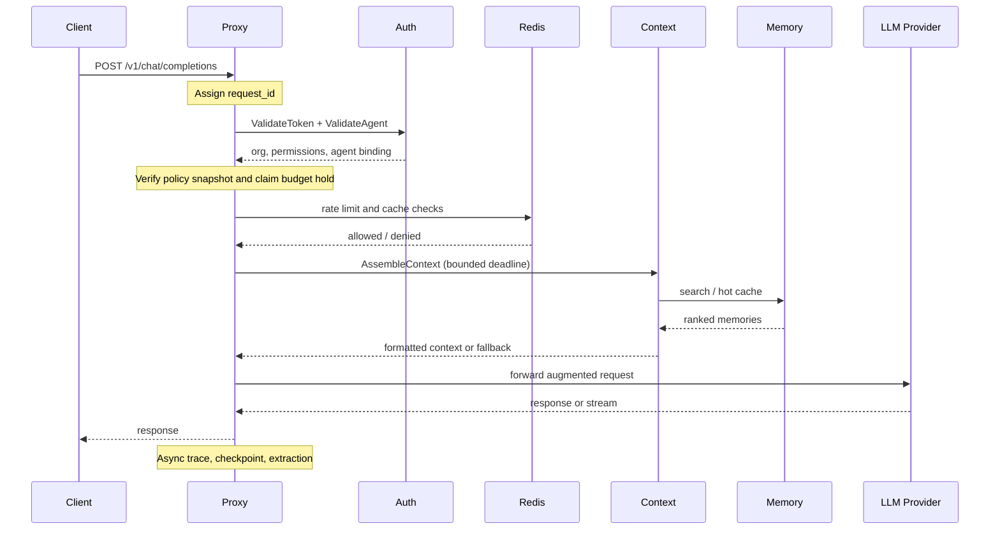

::page-status{status="IMPLEMENTED" verified="2026-10-21"}
::

A protected LLM request enters the proxy as an OpenAI-compatible HTTP call. The proxy validates credentials, confirms agent binding, enforces limits, resolves directives and sessions, assembles bounded context, and forwards to a mock or live provider.

::endpoint
---
{"method":"POST","path":"/v1/chat/completions","description":"OpenAI-compatible chat completions. Tenant scope comes from the PAT; the gateway alias is POST /proxy/v1/chat/completions."}
---
::

## Required headers

| Header | Required | Notes |
| --- | --- | --- |
| `Authorization` | Yes | `Bearer` + PAT (`ibex_pat_...`) |
| `X-IBEX-Agent-ID` | Yes | UUID; must belong to the token organization |
| `Content-Type` | Yes (POST) | `application/json` |
| `X-Request-ID` | No | UUID v7; generated if absent |
| `Idempotency-Key` | No | Supported on bounded non-streaming mutations |
| `X-IBEX-Session-ID` | No | Sticky session identifier |

## Lifecycle steps

::process-steps
---
{"steps":[{"title":"Request ID assigned","description":"Middleware assigns or validates X-Request-ID (UUID v7) and propagates it through logs, metrics, traces, and gRPC metadata."},{"title":"Body gates","description":"Body size and Content-Type are checked before auth. Oversize → 413; wrong media type → 415. This keeps unauthenticated oversized work off the auth path."},{"title":"Bearer token validated","description":"Proxy calls auth ValidateToken over gRPC with a bounded deadline. Success attaches org_id, permissions, and token identity. Missing token → 401; auth unavailable → 503 fail-closed."},{"title":"Agent binding verified","description":"Proxy requires X-IBEX-Agent-ID and confirms it belongs to the token org. Cross-org or unknown agent → 403 before provider logic."},{"title":"Policy and budget admitted","description":"When policy enforcement is configured, the proxy verifies a signed policy snapshot. It then claims a durable hard-cap budget hold when the org has an active budget. Missing authority fails closed."},{"title":"Rate limit checked","description":"Redis sliding-window counter keyed by org. Exceeded → 429 with Retry-After. Redis unavailable → fail-closed SERVICE_DEGRADED in protected profiles; local Noop limiting is explicit only."},{"title":"JSON parsed and validated","description":"The supported chat shape is parsed and validated. Malformed input → 400 with a stable error envelope containing request_id."},{"title":"Directive and session resolved","description":"Org directive and session state are resolved when Postgres/Redis are configured. Session IDs are minted or validated and echoed."},{"title":"Context assembled or skipped","description":"The context client retrieves directive, hot memories, cold memories, and history within a bounded deadline. Retrieval failure degrades to directive-only context rather than blocking inference. The context service is provisional."},{"title":"Provider handoff","description":"The proxy forwards to the mock or live provider adapter and streams the response. Usage, trace, checkpoint, and extraction work remain off the response path."},{"title":"Async evidence and traces","description":"Trace, checkpoint, evidence-outbox, and extraction work are emitted asynchronously. They must never block the client response."}]}
---
::

## Sequence diagram



## Error mapping

| Condition | HTTP | Code |
| --- | --- | --- |
| Missing `Authorization` | 401 | `MISSING_TOKEN` |
| Invalid or revoked PAT | 401 | `INVALID_TOKEN` |
| Agent not in org or binding mismatch | 403 | `AGENT_NOT_AUTHORIZED` |
| Rate limit exceeded | 429 | `RATE_LIMITED` |
| Auth gRPC timeout or unavailable | 503 | `SERVICE_DEGRADED` |
| Model not registered | 501 | `PROVIDER_NOT_CONFIGURED` |
| Context unavailable | 200 with fallback | Degradation recorded; request is not blocked |

Full envelope: [API errors](/docs/api-reference/errors).

## Try the protected path

```bash
curl -s -w "\nHTTP %{http_code}\n" \
  -X POST "http://localhost:8080/v1/chat/completions" \
  -H "Authorization: Bearer ${IBEX_DEV_TOKEN}" \
  -H "X-IBEX-Agent-ID: ${IBEX_DEV_AGENT_ID}" \
  -H "Content-Type: application/json" \
  -d '{"model":"gpt-4o","messages":[{"role":"user","content":"ping"}]}'
```

In default mock mode, a registered model returns HTTP **200**. `501 PROVIDER_NOT_CONFIGURED` means the model is not registered, not that forwarding is unimplemented.

## Synchronous vs asynchronous

**Synchronous:** token validation, agent binding, rate limit, directive/session resolution, bounded context retrieval, provider call, response streaming.

**Asynchronous:** ClickHouse traces, session checkpoints, evidence outbox, extraction, conflict resolution, fingerprinting, drift alerts, billing counters.

The rule is simple: analytics and extraction must never block inference. Context is different: it is on the path but must respect a hard deadline and fall back.

## Architecture decisions

| Topic | ADR |
| --- | --- |
| Proxy to auth gRPC | [ADR-0011](https://github.com/Rick1330/ibex-harness/blob/main/engineering/adr/0011-proxy-auth-client.md) |
| Token validation contract | [ADR-0007](https://github.com/Rick1330/ibex-harness/blob/main/engineering/adr/0007-auth-token-validation.md) |
| Permission bitmap | [ADR-0009](https://github.com/Rick1330/ibex-harness/blob/main/engineering/adr/0009-permission-bitmap.md) |
| Agent identity verification | [ADR-0016](https://github.com/Rick1330/ibex-harness/blob/main/engineering/adr/0016-agent-identity-verification.md) |
| Request ID propagation | [ADR-0017](https://github.com/Rick1330/ibex-harness/blob/main/engineering/adr/0017-request-id-strategy.md) |
| Fail-closed runtime controls | [ADR-0081](https://github.com/Rick1330/ibex-harness/blob/main/engineering/adr/0081-fail-closed-proxy-runtime-controls.md) |
| Context degradation and deadline | [ADR-0071](https://github.com/Rick1330/ibex-harness/blob/main/engineering/adr/0071-context-grpc-degradation-deadline.md) |

## Related

- [Proxy overview](/docs/proxy/overview)
- [Proxy authentication](/docs/proxy/authentication)
- [Context assembly](/docs/context/overview)
- [Status and evidence](/docs/architecture/status-and-evidence)
- [Glossary](/docs/reference/glossary)
