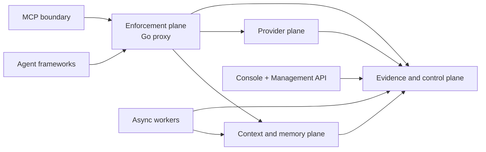

::page-status{status="PROPOSED" verified="2026-10-21" note="Target contract; only the locally evidenced subset is running"}
::

This page describes the **target architecture**, not the current deployment. It exists to keep implementation work aligned with the authority boundaries in `engineering/architecture-v2`. For what is actually running, read [Status and evidence](/docs/architecture/status-and-evidence).

## Planes, not just services

The target separates five concerns so a dependency failure or model output cannot quietly become authority.

| Plane | Owns | Must not do |
| --- | --- | --- |
| Enforcement | Verified principal propagation, deterministic authorization, policy epoch, capability admission, reservations, rate/concurrency, bounded context calls, provider selection, streaming, final allow/deny | Extract memory, run deep PII, render operator views, or treat classifier output as permission |
| Context and memory | Sessions/checkpoints, typed memory, retrieval, PII/quarantine, embeddings, context compilation, provenance-bearing manifests | Widen visibility, promote a candidate into policy, or authorize a provider call |
| Provider | Immutable deployment identities, adapters, capability manifests, tokenizer/pricing metadata, streaming normalization, usage reconciliation, retries, breakers | Authorize a tenant or override a reservation |
| Evidence and control | Canonical configuration, policy/directive lifecycle, provider registry, reservations, operation state, deletion state, transactional outbox, artifact metadata, recovery | Treat ClickHouse, Redis, queues, or OTel as the sole authority |
| Operator and MCP | Management API, Console/BFF, narrow authenticated MCP tools | Write databases directly, become an OAuth identity provider, or let UI state grant authority |



The current codebase implements parts of this map: the Go proxy is the enforcement edge today, the Python memory service owns memory writes and reads, and the management API owns some control-plane routes. The target adds explicit contracts between them; it does not mean every plane is independently deployable.

## Authority lattice

The target ordering is:

```text
verified principal → policy snapshot → capability admission → reservation
→ authorized context → provider/tool execution → evidence/reconciliation
```

A downstream layer cannot manufacture authority an upstream layer did not grant. This is stricter than ordinary service layering:

- A valid bearer token is necessary but not sufficient; the selected agent must match any token binding.
- A retrieval score, cache hit, model confidence, memory body, tool description, or provider response is **data**, not permission.
- Missing, stale, contradictory, or unavailable security state denies or returns a typed dependency failure. It never becomes an empty allow.
- A run identifier is lineage and correlation only. Reusing or forging a run does not carry authority.

The proposed `PrincipalContext` and `RunEnvelope` contracts formalize this, but neither is a repo-wide runtime contract today. See [ADR-0084](https://github.com/Rick1330/ibex-harness/blob/main/engineering/adr/0084-g0-principal-agent-binding-and-idempotency.md).

## Canonical ownership

| Store or component | Canonical role | Not authoritative for |
| --- | --- | --- |
| PostgreSQL | Tenants, policy, provider registry, reservations, operations, lifecycle, outbox | Approximate search ranking |
| Redis | Namespaced cache, bounded counters and leases, hot projection | Durable auth, billing, audit, deletion truth |
| pgvector and full-text search | Search projections | Visibility or semantic truth |
| ClickHouse | Tenant-filtered analytics and evidence projection | Sole audit authority |
| Object storage | Classified large or redacted artifacts; immutable model artifacts | An undeclared source of truth |
| Queue/Celery/streams | Delivery transport | Exactly-once effects without idempotent handling |
| OpenTelemetry | Export and correlation | Durable audit ledger |
| Browser/Console | Presentation and API client | Policy or direct storage access |

Two consequences matter operationally:

1. **Projections must be rebuildable or explicitly marked otherwise.** A cache or index cannot be the only copy of a deletion or authorization decision.
2. **Tombstones suppress reads immediately.** Physical purge is asynchronous; a delayed projection must not resurrect the row.

## Trust-boundary matrix

| Boundary | Verified authority source | Caller-controlled selectors | Required failure behavior |
| --- | --- | --- | --- |
| HTTP to proxy | AuthService validation plus enforcement policy | Agent, project, session, resource IDs | Deny or typed 503 before downstream work |
| Proxy to context | Server-bound principal context | Context selectors only | Reject mismatch or unavailable verifier; no permissive fallback |
| Worker job | Authenticated operation/run envelope | Job payload references | Revalidate tenant, resource, and policy before mutation |
| MCP | Resource-server principal plus tool registry/policy | Tool arguments and resource IDs | Deny before memory or effect call; avoid existence leaks |
| Evidence | Server-generated operation/event envelope | None for authority fields | Reject unscoped or unredacted payloads before persistence |

The first row is implemented locally through the proxy's token and agent checks. The rest are target contracts or narrow local slices, not universal enforcement.

## Deployment profiles

| Profile | Intended use | What acceptance means |
| --- | --- | --- |
| Development Compose | Local contributor workflow | Convenience. No availability, recovery, or hosted claim. |
| Single-node self-hosted | Small controlled installation | Documented backup, resource, dependency, and operator limits. |
| HA production | Hosted or engineered production | Named owners, recovery drills, SLO evidence, isolation proof, and incident ownership. |

Evidence must name the profile. A feature accepted in Compose is not automatically accepted in HA production. The Helm chart in `infra/helm/ibex-harness` is render/lint scaffolding with sentinel images; it is not a deployable production topology.

## Current versus target

| Capability | Local current state | Target contract |
| --- | --- | --- |
| Principal propagation | AuthService validation plus proxy agent checks | Signed `PrincipalContext` across protected boundaries |
| Policy authority | Signed snapshots in selected proxy paths | Immutable snapshot with epoch, digest, freshness, and deny semantics everywhere |
| Idempotency | Durable PostgreSQL ledger for registered slices | Per-operation scope, canonical body hash, replay/conflict semantics |
| Budget reservation | Durable hard-cap holds in a bounded path | Atomic admission and reconciliation with no double-spend |
| Memory lifecycle | Typed rows, tombstones, revision fences, provisional forget | Provenance ledger with deletion certificates and projection fencing |
| Evidence | PostgreSQL outbox plus default-off relay | Durable-before-ack where required, production sink, recovery proof |
| Operator reads | Mounted D1/D2 metadata slices | Versioned support surface with hosted identity, origin, and retention evidence |

## What this page does not claim

- No repo-wide `PrincipalContext`, `RunEnvelope`, or policy snapshot is enforced today.
- No atomic reservation or exactly-once billing claim is supported.
- No production ClickHouse sink, hosted recovery, or HA topology is accepted.
- No model classifier or advisory service can authorize, delete, or widen scope.
- No current latency number is a hosted SLO.

## Related

- [Overview](/docs/architecture/overview) — running components
- [Request lifecycle](/docs/architecture/request-lifecycle) — the current protected path
- [Status and evidence](/docs/architecture/status-and-evidence) — evidence labels and open gaps
- [Security overview](/docs/security/overview) — fail-closed rules
- [Compatibility and versioning](/docs/reference/compatibility) — supported surfaces and change policy
