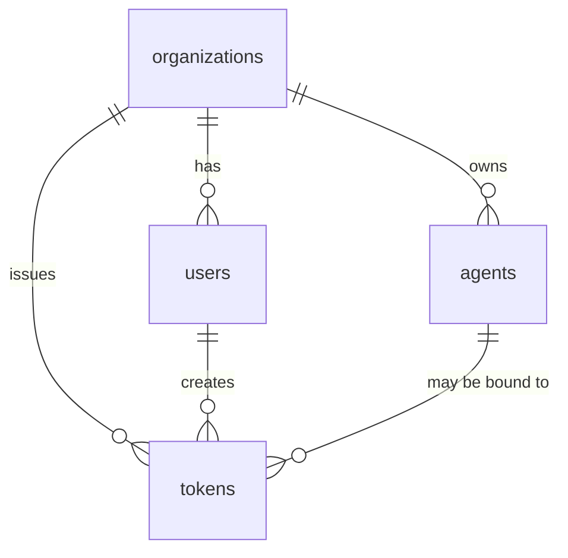

The organization is the tenant boundary. Users manage it, agents act in it, and tokens carry its scope.

::page-status{status="IMPLEMENTED" verified="2026-10-21"}
::

## Entities



### Organization

The root tenant. All durable customer data carries `org_id`. The organization is derived from the validated token, never from a chat request body.

### User

A human operator with an org role: `owner`, `admin`, `member`, or `viewer`. Users are not agents. Operator sessions and TOTP belong to the management plane.

### Agent

A compute identity. The proxy requires `X-IBEX-Agent-ID` and verifies that the agent is active and belongs to the token's organization.

### Token

A PAT or org-scoped credential with a permission bitmap. A token may optionally be bound to a user or agent, further narrowing its scope.

There is **no project entity** in the current schema or API. Do not build project-scoped URLs.

## Runtime binding rules

| Rule | Enforcement |
| --- | --- |
| Token org is authoritative | Proxy middleware after `ValidateToken` |
| Agent must belong to token org | `ValidateAgent` plus store predicates |
| Path org must match token org | `/v1/orgs/{org_id}/auth-probe` |
| Proxy cross-tenant agent | `403` |
| Management/memory resource lookup | `404` for unknown or out-of-tenant IDs |

Chat completions use `POST /v1/chat/completions` with organization scope from the token. There is no `{org_id}` path segment on chat.

## Required headers

```text
Authorization: Bearer ibex_pat_<uuid>_<secret>
X-IBEX-Agent-ID: <agent-uuid>
```

The agent must be `active`. Paused, suspended, or archived agents are rejected.

## Seed data

```bash
make db-migrate
make db-seed
```

| Entity | Fixed UUID |
| --- | --- |
| Organization | `00000000-0000-0000-0000-000000000001` |
| Agent | `00000000-0000-0000-0000-000000000003` |
| Token | `00000000-0000-0000-0000-000000000004` |

`make db-seed` refuses non-local DSNs and `IBEX_ENV=production`.

## Operating guidance

- Issue one PAT per integration environment.
- Register one agent per autonomous service instance.
- Keep token permissions minimal.
- Rotate through the API, not by editing rows.
- Never use a user token where a narrow agent token is sufficient.

## Verify org binding

```bash
curl -s "http://localhost:8080/v1/orgs/${IBEX_DEV_ORG_ID}/auth-probe" \
  -H "Authorization: Bearer ${IBEX_DEV_TOKEN}" \
  -H "X-IBEX-Agent-ID: ${IBEX_DEV_AGENT_ID}"
```

A mismatched path organization returns `403`.

## Related

- [Multi-tenant RLS](/docs/auth/multi-tenant-rls)
- [Issuing API keys](/docs/auth/issuing-api-keys)
- [Proxy authentication](/docs/proxy/authentication)
- [Concepts](/docs/getting-started/concepts)
