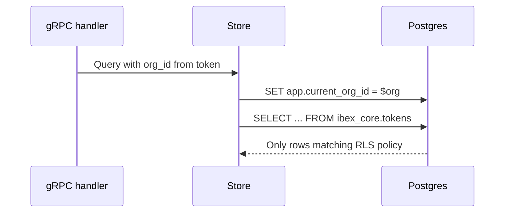

::page-status{status="IMPLEMENTED" verified="2026-10-21"}
::

Postgres row-level security (RLS) ensures each organization's data is invisible to other tenants, even if application code regresses. Policies live in the `ibex_core` schema and ship with versioned migrations under `infra/migrations/` ([ADR-0005](https://github.com/Rick1330/ibex-harness/blob/main/engineering/adr/0005-postgres-migration-strategy.md)).

RLS is one layer in a defense-in-depth model — auth queries **still** include explicit `org_id` filters. See [Tenant isolation](/docs/security/tenant-isolation).

::callout
---
{"type":"note","title":"Defense in depth"}
---

  Application org checks, RLS, and surface-specific error semantics reduce enumeration and data leaks. Proxy identity mismatches return `403`; management/memory resource lookups return `404` where existence leakage matters. A single missing check should not compromise isolation.

::

## How session org context works



Auth sets `app.current_org_id` (or equivalent session variable) before every tenant-scoped query. Policies reference this setting — queries without it see zero rows or fail closed depending on table policy.

## Protected tables

RLS is not limited to identity. The current schema includes tenant-scoped policies across identity, directives, sessions, memory, provider credentials, evidence, privacy, and billing configuration.

| Group | Representative tables |
| --- | --- |
| Identity | `organizations`, `users`, `agents`, `tokens`, `provider_credentials` |
| Conversation | `sessions`, `checkpoints`, `directives`, `directive_versions` |
| Memory | `memories`, `memory_labels`, `memory_relationships`, `memory_feedback` |
| Evidence | `evidence_runs`, `evidence_spans`, `evidence_events`, `evidence_outbox` |
| Privacy | `privacy_audit_ledger`, `legal_holds`, `org_capture_policies` |
| Billing config | `budget_periods`, `rate_cards`, `enforcement_decisions` |

A new tenant table must ship with RLS enabled in the migration that creates it.

## Migration workflow

::steps

### Start Postgres

    `make compose-dev-up` — dev DSN on port 5432.
  
### Apply migrations

    `make db-migrate` — idempotent; records version in schema_migrations.
  
### Optional seed

    `make db-seed` — dev rows only; never on staging/production.
  
### CI parity

    Every PR runs `db-migrate-smoke` against ephemeral Postgres.
  
::

Roll back one step in dev only: `make db-migrate-down`. Check version: `make db-version`.

## Verify RLS is enabled

```bash
psql "$POSTGRES_DSN" -c \
  "SELECT tablename, rowsecurity FROM pg_tables WHERE schemaname = 'ibex_core';"
```

Expected: `rowsecurity = t` on core tenant tables.

Inspect policies:

```sql
SELECT polname, polcmd, polroles::regrole[]
FROM pg_policy p
JOIN pg_class c ON p.polrelid = c.oid
JOIN pg_namespace n ON c.relnamespace = n.oid
WHERE n.nspname = 'ibex_core';
```

## Cross-tenant denial contract

When org A requests org B's agent or token:

| Layer | Behavior |
| --- | --- |
| Proxy | `403 AGENT_NOT_AUTHORIZED` or `INSUFFICIENT_PERMISSIONS` |
| gRPC | `PermissionDenied` — not `NotFound` |
| Store | `(nil, nil)` for wrong-org row — mapped to 403 |
| RLS | Zero rows returned even if WHERE clause regresses |

Ambiguous denials prevent attackers from learning whether a UUID exists in another org. Audit logs record cross-tenant attempts in production configurations.

## Redis and application namespacing

RLS protects Postgres only. Other stores namespace by org at the key level:

```text
ratelimit:{org_id}:rpm:{minute}
auth:token:{sha256_hash}   # hash scoped; org in cached payload
```

ClickHouse has no RLS. Every query must filter `org_id` explicitly; there is no application-wide enforcement switch.

## Testing isolation

```bash
make compose-test-up
go test -tags=integration ./services/auth/...
go test -tags=integration -run '^TestSecurity_' ./services/proxy/...
```

Auth store integration tests use real Postgres (testcontainers or compose-test on port 5433). Windows developers: set `$env:POSTGRES_TEST_DSN` to dev Postgres on 5432 if preferred.

::callout
---
{"type":"warning","title":"Never disable RLS in production"}
---

  Local debugging with superuser bypass is acceptable; production roles must not hold `BYPASSRLS`.

::

## Policy evolution rules

From ADR-0005:

- New tenant tables ship with RLS enabled in the **same migration** that creates the table
- Policy changes require integration tests proving cross-org denial
- Breaking policy changes need an ADR and compatibility plan

## Related

- [Org and project model](/docs/auth/org-project-model) — entity relationships
- [Auth overview](/docs/auth/overview) — who sets session org context
- [Security overview](/docs/security/overview) — threat model
- [ADR-0005](https://github.com/Rick1330/ibex-harness/blob/main/engineering/adr/0005-postgres-migration-strategy.md) — migration sequencing
- [ADR-0014](https://github.com/Rick1330/ibex-harness/blob/main/engineering/adr/0014-core-domain-migration-sequencing.md) — users and agents schema
