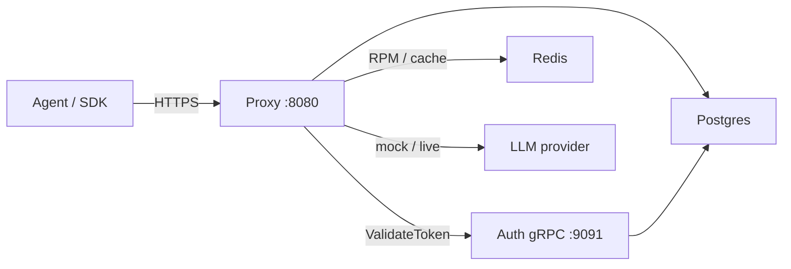

::page-status{status="IMPLEMENTED" verified="2026-10-21"}
::

The proxy is the public HTTP edge for IBEX Harness. Every protected request passes through authentication, agent identity verification, rate limiting, directive resolution, and provider routing before returning a completion.

::callout
---
{"type":"info","title":"Current scope"}
---

  Auth, agent verification, semantic validation, org rate limits, mock/live forwarding, directives, sessions, and optional ClickHouse traces are **implemented locally**. Context retrieval and assembly are **provisional** and must degrade safely. Track the claim boundary in [Status and evidence](/docs/architecture/status-and-evidence).

::

## Role in the platform

The proxy stays horizontally scalable: identity validation goes through the [auth service](/docs/auth/overview) over gRPC (with an optional bloom+LRU cache), rate-limit and idempotency state live in Redis, and session/directive data use Postgres when `POSTGRES_DSN` is set.

See [Architecture overview](/docs/architecture/overview) for the full system diagram and [Request lifecycle](/docs/architecture/request-lifecycle) for the end-to-end flow.

## Endpoint surface

| Route | Auth | Purpose |
| --- | --- | --- |
| `GET /health` | No | Liveness — minimal JSON per [ADR-0022](https://github.com/Rick1330/ibex-harness/blob/main/engineering/adr/0022-health-check-contract.md) |
| `GET /ready` | No | Readiness — probes `auth_grpc` and `redis` when configured |
| `GET /metrics` | No | Prometheus text exposition |
| `GET /v1/internal/auth-probe` | PAT + agent | Returns `{org_id, permissions}` from validated token |
| `GET /v1/orgs/{org_id}/auth-probe` | PAT + agent | Same probe; path `org_id` must match token org |
| `POST /v1/chat/completions` | PAT + agent + `ProxyChatCompletion` | OpenAI-compatible chat — mock **200** or live forward |
| `POST /v1/responses` | PAT + agent + `ProxyChatCompletion` | Responses subset; non-streaming and capability-gated |
| `POST /v1/sessions/{session_id}/terminate` | PAT + agent + `SessionTerminate` | Complete a session and enqueue extraction |

Organization scope for chat comes from the **validated token**, not the URL path. Cross-tenant path probes return `403` — see [Tenant isolation](/docs/security/tenant-isolation).

## Middleware pipeline

Global middleware wraps every route: metrics → request context → response headers → logging → mux.

Protected chat completions add:

::process-steps
---
{"steps":[{"title":"Body limit and Content-Type","description":"Rejects oversize payloads and non-JSON POST bodies before auth runs (ADR-0013)."},{"title":"Token validation","description":"Calls auth ValidateToken over gRPC (50ms production budget), optionally via auth cache when Redis revocation is healthy (ADR-0011, ADR-0028)."},{"title":"Agent verification","description":"Requires X-IBEX-Agent-ID; confirms an active agent belongs to the token org (ADR-0016)."},{"title":"Policy and budget admission","description":"Verifies a signed policy snapshot when configured, then claims a durable hard-cap budget hold when the org has one. Missing authority fails closed."},{"title":"Rate limit","description":"Org-level RPM in Redis. Outside development, Redis failure returns 503 before provider work (ADR-0081)."},{"title":"Directive resolve","description":"Loads org directive versions and prepares system-prompt injection (ADR-0031)."},{"title":"Parse, route, forward","description":"Parses the request, selects the model adapter, optionally assembles context, and forwards. Unknown models return 501."}]}
---
::

Auth-probe routes skip body limit and Content-Type checks but still run auth, agent verify, and rate limit.

## Failure modes

| Dependency | Behavior | HTTP signal |
| --- | --- | --- |
| Auth gRPC down / timeout | Fail **closed** on token validation | `503 SERVICE_DEGRADED` |
| Auth gRPC down on agent verify | Fail **closed** | `503 AUTH_UNAVAILABLE` |
| Redis unreachable at startup | Rate limit fails **closed**; auth cache is not wrapped | `503 SERVICE_DEGRADED`; provider handler is not called; monitor `/ready` |
| Unknown model | No adapter for that model id | `501 PROVIDER_NOT_CONFIGURED` |
| ClickHouse down | Traces drop | Chat still **200** |

Full threat-model context: [Security overview](/docs/security/overview) and [Authentication](/docs/security/authentication).

## Response headers

Every response includes correlation headers (names configurable via env):

- `X-Request-ID` — UUID v7 when generated; valid inbound v4/v7 UUIDs are honoured ([ADR-0017](https://github.com/Rick1330/ibex-harness/blob/main/engineering/adr/0017-request-id-strategy.md))
- `X-Trace-ID` — OpenTelemetry trace correlation
- `X-Response-Time` — server-side duration

Protected routes with rate limiting enabled also emit `X-RateLimit-Limit`, `X-RateLimit-Remaining`, and `X-RateLimit-Reset`. `429` responses add `Retry-After`.

## Verify locally

::steps

### Boot dependencies

    `make compose-dev-up && make db-migrate && make db-seed`
  
### Start auth then proxy

    Auth must listen on gRPC `9091` before the proxy starts. See [Configuration](/docs/proxy/configuration).
  
### Health check

    `curl -s http://localhost:8080/health` — expect HTTP 200.
  
### Smoke test

    `make dev-smoke` exercises probes, auth failures, and mock chat success.
  
::

## Related guides

- [Authentication](/docs/proxy/authentication) — headers, error codes, probe examples
- [Auth caching](/docs/proxy/auth-caching) — bloom+LRU and revocation gate
- [Directives](/docs/proxy/directives) / [Sessions](/docs/proxy/sessions) — platform features
- [Configuration](/docs/proxy/configuration) — env vars and readiness dependencies
- [Rate limiting](/docs/proxy/rate-limiting) — RPM budgets and Redis keys
- [Provider adapters](/docs/proxy/provider-adapters) — mock vs live
