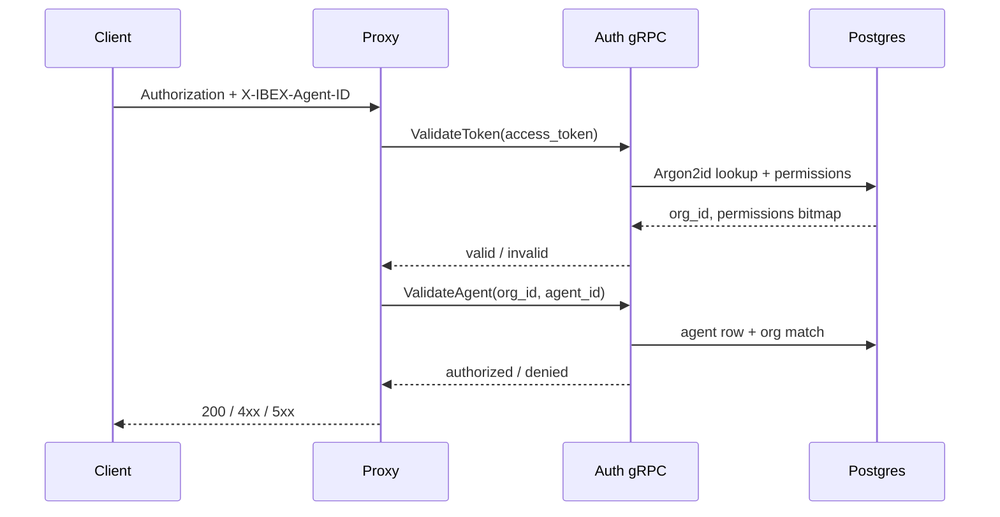

::page-status{status="IMPLEMENTED" verified="2026-10-21"}
::

Protected proxy routes require two credentials: a Personal Access Token (PAT) in the `Authorization` header and an active agent UUID in `X-IBEX-Agent-ID`. The proxy never stores token hashes — every validation is delegated to the auth service over gRPC ([ADR-0011](https://github.com/Rick1330/ibex-harness/blob/main/engineering/adr/0011-proxy-auth-client.md), [ADR-0016](https://github.com/Rick1330/ibex-harness/blob/main/engineering/adr/0016-agent-identity-verification.md)).

::callout
---
{"type":"warning","title":"Fail-closed on auth outage"}
---

  When auth gRPC is unavailable, token validation returns `503 SERVICE_DEGRADED` and agent verification returns `503 AUTH_UNAVAILABLE`. Auth cache only wraps successful validations when Redis revocation is healthy — it never bypasses fail-closed auth.

::

## Required headers

| Header | Required on | Description |
| --- | --- | --- |
| `Authorization` | All protected routes | `Bearer ibex_pat_<uuid>_<secret>` |
| `X-IBEX-Agent-ID` | All protected routes | UUID of an **active** agent owned by the token's org |
| `Content-Type` | `POST` bodies | Must be `application/json` on chat completions |

Organization scope is derived from the **validated token**, not from request body fields. Never send `org_id` in JSON to select a tenant — that would be a spoofing vector. See [Security authentication](/docs/security/authentication).

## Validation flow



Chat completions additionally require the `ProxyChatCompletion` permission bit on the token ([ADR-0009](https://github.com/Rick1330/ibex-harness/blob/main/engineering/adr/0009-permission-bitmap.md)).

## Path org enforcement

Two probe routes help integrators verify credentials:

::endpoint
---
{"method":"GET","path":"/v1/internal/auth-probe","description":"Returns org_id and permissions from the validated token. No path org parameter."}
---
::

::endpoint
---
{"method":"GET","path":"/v1/orgs/{org_id}/auth-probe","description":"Same response shape; path org_id must equal token org or returns 403."}
---
::

Cross-tenant path access returns `403` with an ambiguous message rather than `404`, so the probe is not an existence oracle. Resource APIs use their own not-found semantics. Details: [Tenant isolation](/docs/security/tenant-isolation).

## Probe examples

::tabs

:::tabs-item{label="curl"}

```bash
# Internal probe — org from token
curl -s http://localhost:8080/v1/internal/auth-probe \
  -H "Authorization: Bearer ${IBEX_DEV_TOKEN}" \
  -H "X-IBEX-Agent-ID: ${IBEX_DEV_AGENT_ID}"

# Path org probe — must match token org
curl -s "http://localhost:8080/v1/orgs/${IBEX_DEV_ORG_ID}/auth-probe" \
  -H "Authorization: Bearer ${IBEX_DEV_TOKEN}" \
  -H "X-IBEX-Agent-ID: ${IBEX_DEV_AGENT_ID}"
```
  
:::

:::tabs-item{label="PowerShell"}

```powershell
$headers = @{
  Authorization = "Bearer $env:IBEX_DEV_TOKEN"
  "X-IBEX-Agent-ID" = $env:IBEX_DEV_AGENT_ID
}
Invoke-RestMethod http://localhost:8080/v1/internal/auth-probe -Headers $headers
```
  
:::

::

Successful probe response:

```json
{
  "org_id": "00000000-0000-0000-0000-000000000001",
  "permissions": 23
}
```

## Chat completion probe

After auth and agent checks pass, mock-mode chat returns **200** for registered models:

::tabs

:::tabs-item{label="curl"}

```bash
curl -s -X POST http://localhost:8080/v1/chat/completions \
  -H "Authorization: Bearer ${IBEX_DEV_TOKEN}" \
  -H "X-IBEX-Agent-ID: ${IBEX_DEV_AGENT_ID}" \
  -H "Content-Type: application/json" \
  -d '{"model":"gpt-4o","messages":[{"role":"user","content":"ping"}]}'
```
  
:::

:::tabs-item{label="PowerShell"}

```powershell
$headers = @{
  Authorization = "Bearer $env:IBEX_DEV_TOKEN"
  "Content-Type" = "application/json"
  "X-IBEX-Agent-ID" = $env:IBEX_DEV_AGENT_ID
}
$body = '{"model":"gpt-4o","messages":[{"role":"user","content":"ping"}]}'
Invoke-RestMethod -Uri http://localhost:8080/v1/chat/completions -Method POST -Headers $headers -Body $body
```
  
:::

::

Expected (mock): HTTP **200**. A `501 PROVIDER_NOT_CONFIGURED` means the model is not registered.

## Error matrix

| HTTP | Code | When |
| --- | --- | --- |
| `401` | `MISSING_TOKEN` / `INVALID_TOKEN` | Missing, malformed, expired, or revoked PAT |
| `400` | `MISSING_AGENT_ID` | `X-IBEX-Agent-ID` absent or not a UUID |
| `403` | `AGENT_NOT_AUTHORIZED` | Agent missing, wrong org, or cross-tenant path |
| `403` | `AGENT_SUSPENDED` | Agent exists but is not active |
| `403` | `INSUFFICIENT_PERMISSIONS` | Path `org_id` ≠ token org on org-scoped routes |
| `503` | `SERVICE_DEGRADED` | Auth gRPC timeout or unavailable on token validation |
| `503` | `AUTH_UNAVAILABLE` | Auth gRPC failure on agent verification |

Full envelope reference: [API errors](/docs/api-reference/errors). Security integration tests cover 35+ negative cases — see [current state](/docs/architecture/status-and-evidence).

## Issue a dev PAT

::steps

### Seed local data

    `make db-seed` writes a fixed dev PAT and exports `IBEX_DEV_TOKEN`, `IBEX_DEV_AGENT_ID`, `IBEX_DEV_ORG_ID`.
  
### Or create via gRPC

    Use `CreateToken` with an admin bearer — see [Issuing API keys](/docs/auth/issuing-api-keys).
  
### Never log secrets

    Log only token prefixes in application code. Rotation procedure: [Secrets and keys](/docs/security/secrets-and-keys).
  
::

## Related

- [Auth overview](/docs/auth/overview) — gRPC surface and token lifecycle
- [Org and project model](/docs/auth/org-project-model) — how agents map to orgs
- [Overview](/docs/proxy/overview) — full middleware order
- [Request routing](/docs/proxy/request-routing) — body validation after auth
