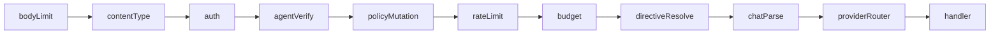
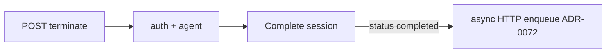

::page-status{status="IMPLEMENTED" verified="2026-10-21"}
::

The proxy exposes an OpenAI-compatible chat completion endpoint and diagnostic auth probes. Every chat request is parsed, validated, and authenticated end-to-end, then routed to the mock or live provider ([ADR-0012](https://github.com/Rick1330/ibex-harness/blob/main/engineering/adr/0012-proxy-request-normalization.md), [ADR-0013](https://github.com/Rick1330/ibex-harness/blob/main/engineering/adr/0013-proxy-input-validation-and-error-envelope.md)).

::callout
---
{"type":"note","title":"Org scope from token"}
---

  `POST /v1/chat/completions` does **not** include `org_id` in the URL. Tenant scope comes from the validated PAT. Path-based org probes exist only on `/v1/orgs/{org_id}/auth-probe`.

::

## Protected routes

::endpoint
---
{"method":"POST","path":"/v1/chat/completions","description":"OpenAI-compatible chat completions. Requires ProxyChatCompletion permission. Mock mode returns 200; unknown models return 501."}
---
::

::endpoint
---
{"method":"GET","path":"/v1/internal/auth-probe","description":"Diagnostic route returning org_id and permissions from the bearer token."}
---
::

::endpoint
---
{"method":"GET","path":"/v1/orgs/{org_id}/auth-probe","description":"Diagnostic route with explicit path org; must match token org."}
---
::

## Middleware chain for chat



Inside the chat handler (not a middleware hop): when `IBEX_CONTEXT_ENABLED` and a context client are present, **Assemble** runs via gRPC, then messages are injected and forwarded to the provider. Failures fail open to directive-only injection.

Session termination is a separate authenticated route, `POST /v1/sessions/{session_id}/terminate`:



Global middleware (metrics, request ID, logging) wraps all routes. Chat-specific middleware runs in the order above — auth never executes on oversize or wrong Content-Type bodies. `chatParse` attaches the validated body; `providerRouter` attaches the selected `provider.Provider` (or returns `501 PROVIDER_NOT_CONFIGURED`).

## Normalization pipeline

::process-steps
---
{"steps":[{"title":"Body size gate","description":"Payloads over IBEX_MAX_REQUEST_BODY_BYTES (default 1 MiB) return 413 before JSON parse."},{"title":"Content-Type gate","description":"POST bodies must be application/json; otherwise 415."},{"title":"JSON parse","description":"Malformed JSON returns 400 INVALID_JSON with request_id in the envelope."},{"title":"Semantic validation","description":"Required fields (model, messages) produce field_errors array per ADR-0013."},{"title":"Provider handoff","description":"ProviderRoutingMiddleware resolves model → adapter; unknown models return 501 PROVIDER_NOT_CONFIGURED. Handler forwards via context provider."}]}
---
::

## Minimal valid body

```json
{
  "model": "gpt-4o",
  "messages": [
    { "role": "user", "content": "Hello" }
  ]
}
```

## Validation error example

HTTP **400** with structured field errors:

```json
{
  "error": {
    "code": "VALIDATION_ERROR",
    "message": "Request validation failed",
    "request_id": "0192a3b4-c5d6-7890-abcd-ef1234567890",
    "timestamp": "2026-06-14T12:00:00Z",
    "field_errors": [
      {
        "field": "model",
        "code": "REQUIRED",
        "message": "model is required"
      }
    ]
  }
}
```

Optional `docs_url` appears when `IBEX_ERROR_DOCS_BASE` is configured — links to [API errors](/docs/api-reference/errors).

## Send a routed request

::tabs

:::tabs-item{label="curl"}

```bash
curl -s -w "\nHTTP %{http_code}\n" \
  -X POST http://localhost:8080/v1/chat/completions \
  -H "Authorization: Bearer ${IBEX_DEV_TOKEN}" \
  -H "X-IBEX-Agent-ID: ${IBEX_DEV_AGENT_ID}" \
  -H "Content-Type: application/json" \
  -d '{"model":"gpt-4o","messages":[{"role":"user","content":"ping"}]}'
```
  
:::

:::tabs-item{label="PowerShell"}

```powershell
$headers = @{
  Authorization = "Bearer $env:IBEX_DEV_TOKEN"
  "Content-Type" = "application/json"
  "X-IBEX-Agent-ID" = $env:IBEX_DEV_AGENT_ID
}
$body = '{"model":"gpt-4o","messages":[{"role":"user","content":"ping"}]}'
Invoke-RestMethod -Uri http://localhost:8080/v1/chat/completions -Method POST -Headers $headers -Body $body
```
  
:::

::

Default mock mode expected: HTTP **200** for registered models. `501 PROVIDER_NOT_CONFIGURED` means the model is not in the registry.

## Path org enforcement

On `/v1/orgs/{org_id}/auth-probe`, the path parameter must be a valid UUID and must equal the organization embedded in the validated token. Cross-tenant attempts return **403** — never **404** — per [Security authentication](/docs/security/authentication).

| Scenario | HTTP | Code |
| --- | --- | --- |
| Invalid UUID in path | `400` | `VALIDATION_ERROR` |
| Token org A, path org B | `403` | `INSUFFICIENT_PERMISSIONS` |
| Matching org | `200` | — |

## Request correlation

Every response includes:

- `X-Request-ID` — propagated to auth gRPC as `x-request-id` metadata
- `X-Trace-ID` — OpenTelemetry trace
- `X-Response-Time` — handler duration

Use `request_id` from JSON errors to grep proxy and auth logs during integration debugging. See [Request lifecycle](/docs/architecture/request-lifecycle).

## Provider forwarding

For each admitted request the handler:

1. Uses the adapter selected by the model router, including per-org model policy when configured.
2. Applies directive injection and optional assembled context.
3. Calls the mock or live provider with a bounded request context.
4. Returns JSON or streams SSE in the OpenAI-compatible shape.
5. Emits traces, usage facts, session checkpoints, and evidence asynchronously.

A provider error is mapped into the stable envelope. A missing model is `501 PROVIDER_NOT_CONFIGURED`; it is not a missing-adapter bug.

See [Provider adapters](/docs/proxy/provider-adapters) for mock vs live configuration and [Status and evidence](/docs/architecture/status-and-evidence) for the remaining gates.

## Related

- [Authentication](/docs/proxy/authentication) — credentials required before routing
- [Provider adapters](/docs/proxy/provider-adapters) — upstream contract and modes
- [Overview](/docs/proxy/overview) — full endpoint table
- [Chat completions](/docs/api-reference/chat-completions) — request shape and headers
