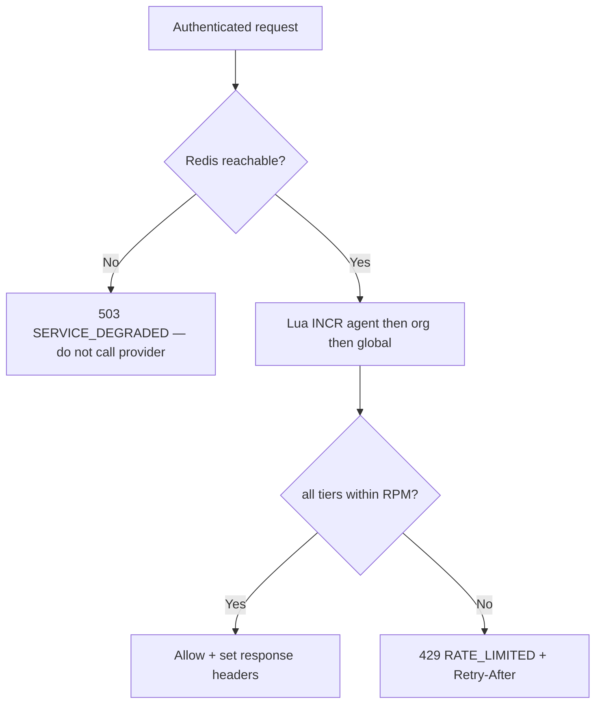

::page-status{status="IMPLEMENTED" verified="2026-10-21"}
::

The proxy enforces hierarchical requests-per-minute (RPM) limits (agent → org → global) using one atomic Redis Lua round trip ([ADR-0015](https://github.com/Rick1330/ibex-harness/blob/main/engineering/adr/0015-proxy-rate-limit-skeleton.md), milestone 4.B.1). Limits apply **after** authentication and agent verification succeed and **before** request normalization hands off to a provider adapter.

Shared rate limiting is an enforced control for provider traffic. Outside local development, `REDIS_URL` is required; a Redis operation failure returns `503 SERVICE_DEGRADED` and does not call a provider. A quota denial remains `429 RATE_LIMITED`. See [ADR-0081](https://github.com/Rick1330/ibex-harness/blob/main/engineering/adr/0081-fail-closed-proxy-runtime-controls.md); the historical fail-open choice in [ADR-0015](https://github.com/Rick1330/ibex-harness/blob/main/engineering/adr/0015-proxy-rate-limit-skeleton.md) is historical and superseded for the current Proxy runtime.

::callout
---
{"type":"warning","title":"Redis is an availability dependency"}
---

  When Redis is unreachable, affected protected requests are rejected with 503 rather than sent to a provider without the configured shared limit. Restore Redis or disable the affected Proxy capability; do not bypass rate limiting. Local development may explicitly omit Redis and use the Noop limiter.

::

## How it works



Implementation lives in `packages/ratelimit` (`HierarchicalLimiter`) — services must use the `Limiter` interface, not ad-hoc Redis calls. The agent key is `ratelimit:{org_id}:agent:{agent_id}:rpm:{unix_minute}`, the org key is `ratelimit:{org_id}:rpm:{unix_minute}`, and the global key is shared by the deployment. Each key receives a TTL on first increment in the current UTC minute.

## Configuration

| Name | Type | Required | Description |
| --- | --- | --- | --- |
| `IBEX_RATE_LIMIT_DEFAULT_RPM` | `integer` | No | Seed RPM for an org and for each agent without an override. The built-in default is 60 when unset or below 1. |
| `IBEX_RATE_LIMIT_GLOBAL_RPM` | `integer` | No | Shared RPM ceiling across all proxy instances using the same Redis namespace/deployment (applies to all orgs). |
| `IBEX_RATE_LIMIT_ORG_OVERRIDES` | `string` | No | Comma-separated org_uuid=rpm pairs. These override the default org tier; DB-sourced overrides win when present. |
| `REDIS_URL` | `string (URL)` | No | Redis connection used by the limiter and /ready probe; required outside development and optional for explicit development Noop mode. |

Example overrides:

```bash
IBEX_RATE_LIMIT_DEFAULT_RPM=60
IBEX_RATE_LIMIT_GLOBAL_RPM=100000
IBEX_RATE_LIMIT_ORG_OVERRIDES=00000000-0000-0000-0000-000000000001=120,00000000-0000-0000-0000-000000000002=30
```

Org IDs in overrides must be valid UUIDs. The limiter resolves the org from the **authenticated token**, never from the request body. Per-agent overrides come from the database override store and are refreshed through the proxy config subscriber plus a periodic full replacement; there is no environment variable for per-agent RPM.

## Response headers

When rate limiting is active and Redis is healthy, allowed protected responses include:

| Header | Meaning |
| --- | --- |
| `X-RateLimit-Limit` | Resolved org-tier RPM (not the agent-tier limit) |
| `X-RateLimit-Remaining` | Requests left in the org window |
| `X-RateLimit-Reset` | Unix timestamp when the window resets |

On `429`, the proxy also sets `Retry-After` (seconds) and resets the advertised remaining count to zero. The tier that denied is not exposed in headers; a denial can come from an exhausted agent, org, or global budget.

On a rate-limit infrastructure failure, the proxy returns `503 SERVICE_DEGRADED`; this must not be represented as a `429` or as an allowed request.

## Rate-limited error envelope

```json
{
  "error": {
    "code": "RATE_LIMITED",
    "message": "Rate limit exceeded",
    "request_id": "0192a3b4-c5d6-7890-abcd-ef1234567890",
    "timestamp": "2026-06-14T12:00:00Z"
  }
}
```

The `request_id` matches `X-Request-ID` on the response and is propagated to auth gRPC metadata for log correlation ([ADR-0017](https://github.com/Rick1330/ibex-harness/blob/main/engineering/adr/0017-request-id-strategy.md)).

## Routes subject to limiting

All protected `/v1/*` routes share the same hierarchy:

- `GET /v1/internal/auth-probe`
- `GET /v1/orgs/{org_id}/auth-probe`
- `POST /v1/chat/completions`

When an agent identity is present — the verified agent record or, on routes where the record is not yet resolved, the agent header — the proxy checks the agent tier, then the org tier, then the global ceiling. A missing agent UUID skips only the agent tier. Agent RPM defaults to `IBEX_RATE_LIMIT_DEFAULT_RPM`; a DB per-agent override can raise or lower it. There is no per-IP tier and no per-route bucket. Agent denials roll back only the agent increment; org denials roll back the agent increment; global denials roll back both inner increments so a denied request does not consume outer budget.

The advertised `X-RateLimit-*` headers and the `429` message describe the **org** tier even when the agent or global tier caused the denial. Do not use the headers as a per-agent quota display.

## Verify the limiter

::steps

### Start test stack

    `make compose-test-up` — Postgres on 5433; Redis from compose.
  
### Run security tests

    `go test -tags=integration -run TestSecurity_SEC4 ./services/proxy/...`
  
### Optional smoke burst

    `make dev-smoke` may WARN if 429 is not observed in 65 rapid probe requests — acceptable on fast hardware.
  
::

CI exercises both a normal shared-limit decision and Redis-failure rejection, including an assertion that the next handler is not called. See [Testing strategy](/docs/architecture/request-lifecycle) and [current state](/docs/architecture/status-and-evidence).

## Operational guidance

::callout
---
{"type":"tip","title":"Monitor limiter availability"}
---

  Alert on Redis `/ready` failures and `ibex_proxy_rate_limit_redis_errors_total`. The intentional availability trade-off is a 503 on protected work until shared limiter state is restored.

::

- **Staging:** Keep `IBEX_RATE_LIMIT_DEFAULT_RPM` low enough to catch runaway integration tests.
- **Production:** Set per-org overrides for high-traffic tenants; never embed org IDs in metric labels (cardinality explosion).
- **Security:** Pair rate limits with auth — unauthenticated traffic should not reach the limiter on protected routes.

## Related

- [Configuration](/docs/proxy/configuration) — full env var reference
- [Authentication](/docs/proxy/authentication) — limiter runs after auth succeeds
- [Tenant isolation](/docs/security/tenant-isolation) — Redis key namespacing by org_id
- [ADR-0015](https://github.com/Rick1330/ibex-harness/blob/main/engineering/adr/0015-proxy-rate-limit-skeleton.md) — design rationale and race window
