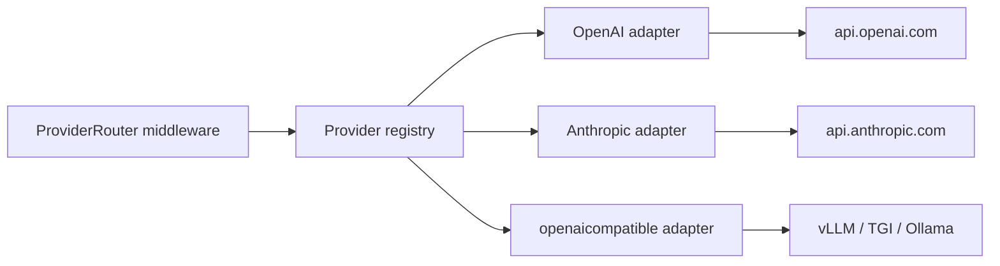

::page-status{status="IMPLEMENTED" verified="2026-10-21"}
::

Provider adapters translate normalized IBEX chat requests into upstream LLM API calls and stream responses back to clients. The registry ships with a **mock** adapter (default), an **OpenAI** adapter, an **Anthropic** adapter ([ADR-0040](https://github.com/Rick1330/ibex-harness/blob/main/engineering/adr/0040-anthropic-provider-adapter.md)), and a self-hosted **OpenAI-compatible** adapter ([ADR-0042](https://github.com/Rick1330/ibex-harness/blob/main/engineering/adr/0042-self-hosted-openai-compatible-adapter.md)).

::callout
---
{"type":"info","title":"Modes"}
---

  `IBEX_LLM_MODE=mock` (default) returns HTTP **200** from the deterministic in-process mock adapter for registered models.
  Set `IBEX_LLM_MODE=live` with `OPENAI_API_KEY`, `ANTHROPIC_API_KEY`, and/or `IBEX_SELFHOSTED_ENABLED=true`
  to register those backends. Live mode requires at least one. Unknown models still return
  `501 PROVIDER_NOT_CONFIGURED`. Design: [ADR-0025](https://github.com/Rick1330/ibex-harness/blob/main/engineering/adr/0025-llm-provider-abstraction.md),
  [ADR-0026](https://github.com/Rick1330/ibex-harness/blob/main/engineering/adr/0026-openai-client-design.md), [ADR-0027](https://github.com/Rick1330/ibex-harness/blob/main/engineering/adr/0027-streaming-dual-write.md),
  [ADR-0040](https://github.com/Rick1330/ibex-harness/blob/main/engineering/adr/0040-anthropic-provider-adapter.md), [ADR-0042](https://github.com/Rick1330/ibex-harness/blob/main/engineering/adr/0042-self-hosted-openai-compatible-adapter.md).

::

## Why adapters exist

IBEX Harness must support multiple LLM vendors without leaking provider specifics into middleware. Adapters isolate:

- Upstream URL and authentication (API keys, Azure deployment IDs)
- Request/response dialect differences (tool calls, streaming chunk format)
- Retry and circuit-breaker policy per provider

The proxy critical path stays provider-agnostic: normalize once, delegate to the registry, stream the response. Target overhead remains under 20ms p99 excluding upstream LLM latency — see [Architecture overview](/docs/architecture/overview).



## Self-hosted OpenAI-compatible (vLLM-first)

Enable with `IBEX_SELFHOSTED_ENABLED=true`, a BaseURL ending in `/v1`, and `IBEX_SELFHOSTED_MODELS`.
Capability overlays use `provider: "openai"` (wire dialect) while the runtime provider name is
`openaicompatible`. Bootstrap probes `GET /models` before registration; `/ready` exposes an advisory
`selfhosted_llm` check. Queue-full (HTTP 503) and circuit-open failures return distinct
`PROVIDER_UNAVAILABLE` details — see [ADR-0042](https://github.com/Rick1330/ibex-harness/blob/main/engineering/adr/0042-self-hosted-openai-compatible-adapter.md).

## Planned adapter contract → Anthropic shipped

Anthropic is implemented in `packages/provider/anthropic/`. It translates Messages API requests/responses
to OpenAI-compatible JSON and SSE so the public `POST /v1/chat/completions` contract and dual-write
forwarder stay unchanged. Built-in models: `claude-sonnet-4-5`, `claude-haiku-4-5`, `claude-opus-4-5`
(plus `ANTHROPIC_EXTRA_MODELS`). Tool-use and image blocks are not guaranteed passthrough; check the capability manifest for the selected model.

::process-steps
---
{"steps":[{"title":"Register at startup","description":"Each configured adapter is registered into provider.Registry by SupportedModels(). Live mode registers OpenAI, Anthropic, and/or self-hosted (openaicompatible) when configured."},{"title":"Receive normalized payload","description":"Input is the validated OpenAI chat JSON plus org_id, agent_id, and request_id from middleware context."},{"title":"Call upstream","description":"Adapter applies provider credentials from process env (never from the client request body). Anthropic uses x-api-key + anthropic-version; self-hosted omits Authorization when the key is empty."},{"title":"Stream response","description":"Return OpenAI-compatible JSON or SSE chunks to the client; accumulate for async trace emission."}]}
---
::

Adapters must not read `org_id` from the request body. Tenant context comes from verified auth middleware only — [Tenant isolation](/docs/security/tenant-isolation).

## Mock vs live behavior

Registered models in mock mode return HTTP **200**. Probe status (not `.error.code`):

::tabs

:::tabs-item{label="curl"}

```bash
curl -s -o /tmp/chat.json -w "%{http_code}\n" http://localhost:8080/v1/chat/completions \
  -H "Authorization: Bearer ${IBEX_DEV_TOKEN}" \
  -H "X-IBEX-Agent-ID: ${IBEX_DEV_AGENT_ID}" \
  -H "Content-Type: application/json" \
  -d '{"model":"gpt-4o","messages":[{"role":"user","content":"hi"}]}'
```
  
:::

:::tabs-item{label="PowerShell"}

```powershell
$headers = @{
  Authorization = "Bearer $env:IBEX_DEV_TOKEN"
  "Content-Type" = "application/json"
  "X-IBEX-Agent-ID" = $env:IBEX_DEV_AGENT_ID
}
$body = '{"model":"gpt-4o","messages":[{"role":"user","content":"hi"}]}'
(Invoke-WebRequest -Uri http://localhost:8080/v1/chat/completions -Method POST -Headers $headers -Body $body).StatusCode
```
  
:::

::

Expected output: `200`.

::callout
---
{"type":"success","title":"Default mock returns 200"}
---

  Registered models in mock mode return HTTP 200. Use `make dev-smoke` for the local happy path. A 501 means the model id is not registered — check spelling or `IBEX_LLM_EXTRA_MODELS`.

::

## Error envelope (unknown model)

```json
{
  "error": {
    "code": "PROVIDER_NOT_CONFIGURED",
    "message": "No LLM provider adapter is configured for this request",
    "request_id": "0192a3b4-c5d6-7890-abcd-ef1234567890",
    "timestamp": "2026-06-14T12:00:00Z"
  }
}
```

This is distinct from `503` dependency failures — the proxy itself is healthy; the requested **model** is not in the active registry.

## What still evolves

::steps

### Registry (shipped)

    Model-to-adapter resolution for mock and OpenAI-compatible live modes.
  
### OpenAI adapter (shipped)

    Non-streaming JSON and streaming SSE dual-write ([ADR-0027](https://github.com/Rick1330/ibex-harness/blob/main/engineering/adr/0027-streaming-dual-write.md)).
  
### Circuit breaker

    Provider 5xx triggers breaker; clients receive `503` with `Retry-After` (hardening continues).
  
### Memory injection

    Context assembly runs before the upstream call when enabled, with directive injection as the fallback.
  
::

Provider API keys are server-side: process environment keys for the default path, or encrypted per-org credentials sealed by auth and resolved under `SecretUse`. They are never accepted from client headers. Rotation guidance: [Secrets and keys](/docs/security/secrets-and-keys).

## Security boundaries

| Control | Today |
| --- | --- |
| Client supplies provider API key | **Forbidden** |
| Org from token | Enforced |
| Audit log per upstream call | ClickHouse traces when `CLICKHOUSE_DSN` set |
| PII in upstream prompts | Memory write-path redaction is implemented; upstream prompt content is not a guaranteed DLP boundary |

## Verify adapters

```bash
make compose-dev-up
make db-migrate && make db-seed
make dev-smoke   # asserts mock chat success without OPENAI_API_KEY
```

Integration tests in `services/proxy/` cover mock success and `PROVIDER_NOT_CONFIGURED` for unknown models.

## Related

- [Request routing](/docs/proxy/request-routing) — normalization before adapter handoff
- [Overview](/docs/proxy/overview) — middleware and failure modes
- [Architecture services](/docs/architecture/services) — proxy role in the system map
- [Status and evidence](/docs/architecture/status-and-evidence) — current provider capability boundary
