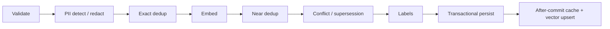

`POST /v1/memories` is an idempotent write pipeline, not a single insert. Each stage has a narrow responsibility and a documented failure mode.

::page-status{status="IMPLEMENTED" verified="2026-10-21"}
::

## Stage order

### 1. Validate

The request must carry an organization and agent scope, content bounds, a source, and valid optional temporal fields. Explicit `labels: []` is invalid. Duplicate labels are rejected. Label count is limited to five.

### 2. PII

Presidio runs a two-tier detect/redact pass. The default redaction confidence is `0.70`; the default spaCy model is `en_core_web_md`. High-confidence findings are replaced with typed placeholders such as `[EMAIL_ADDRESS]`. Low-confidence or disallowed findings can place the record in `quarantined` status.

Quarantined content is not ordinary active memory and must not be injected as trusted context.

### 3. Exact dedup

Content is normalized after PII processing and hashed with SHA-256. An active row with the same hash is treated as an exact duplicate; retrieval metadata is bumped and embedding is skipped. A partial unique index protects active rows.

### 4. Embed

The embedder produces the vector for the redacted content. Embedding failures are errors, not a reason to persist a half-written active record.

### 5. Near dedup

The service searches for a sufficiently similar existing memory. The default threshold is `0.92` with strict greater-than comparison. A match is reported as a near duplicate; it is not silently treated as semantically identical for all purposes.

### 6. Conflict and supersession

Conflict handling is interval-overlap-first:

- Same subject, newer `valid_from`, and non-overlapping intervals can produce `supersedes` without an LLM call.
- Overlapping intervals or missing `valid_from` may use the pluggable classifier.
- Relationships are persisted with explicit tenant scope.

Conflict detection is enabled by default via `IBEX_MEMORY_CONFLICT_DETECTION_ENABLED`.

### 7. Labels

Writes may include one to five labels, each with a confidence. If labels are omitted, the service synthesizes a backward-compatible label from scalar `category` and `confidence`. The application never updates the primary category directly; a database trigger owns that projection.

### 8. Persist and after-commit effects

The memory row, labels, and relationship changes are written in one transaction. After commit, the service updates the optional Redis cache and the vector index. Cache failures do not erase the durable record; they degrade read performance.

## Idempotency

Send `X-Idempotency-Key` for safe retries. The ledger is scoped by `(org, agent, key)`:

| Case | Result |
| --- | --- |
| Same key, same body | Replay the stored 2xx response |
| Same key, different body | `409 IDEMPOTENCY_CONFLICT` |
| Claim still active | `409 IDEMPOTENCY_IN_PROGRESS` with `Retry-After` |
| PostgreSQL unavailable for a keyed write | `503 IDEMPOTENCY_UNAVAILABLE` |
| Row committed but claim cannot finalize | `503`; do not report success over an unfinished claim |

## Logging rule

The pipeline logs identifiers, stage outcomes, and timings. It does not log raw content, embeddings, or credentials. Use the memory ID and request ID for diagnosis.
