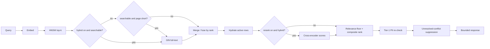

Reads are tenant- and agent-scoped. Durable search uses pgvector; the hot-cache path is optional. The forget route exists but is not an accepted public lifecycle contract.

::page-status{status="PROVISIONAL" verified="2026-11-03"}
::

## Search request

`POST /v1/memories/search` requires `memory:read` and accepts:

| Field | Rules |
| --- | --- |
| `agent_id` | Required; the agent scope is not inferred from a client body |
| `query` | 1–10,000 characters |
| `limit` | 1–50; default 10 |
| `min_similarity` | Optional 0–1; defaults to the configured ANN cutoff (0.70) |
| `min_confidence` | 0–1; default 0 |

The response returns `results[]`, each with the memory, its retrieval `similarity`, a `rank`, and a `source` of `vector` or `full_text`. `similarity` is the retrieval metric, not the final composite score:

- Vector: cosine similarity.
- Full text: `ts_rank_cd` clamped to `[0, 1]`.

The final order is a composite score, so a lower-similarity but much more recent, useful, or confident memory can outrank a stale near-match.

## Two-stage filtering

Do not confuse these thresholds:

| Stage | Default | Purpose |
| --- | --- | --- |
| ANN `min_similarity` | 0.70 | Drops vector candidates before hydration |
| Composite relevance floor | 0.15 | Drops candidates whose relevance component is below the floor before composite scoring |

Full-text hits have no cosine score. For composite scoring they use a fixed relevance sentinel of `0.5`; the HTTP `similarity` still reports `ts_rank_cd`. The relevance floor is constrained to stay below `0.5`, otherwise full-text hits would be mass-excluded.

## Retrieval flow



Two retrieval modes exist, chosen per request by configuration:

- **Sparse fallback** (default). Controlled by `IBEX_MEMORY_SEARCH_FALLBACK_ENABLED`, the GIN full-text channel runs only for a searchable query when vector hits are below the limit.
- **Hybrid.** Controlled by `IBEX_MEMORY_SEARCH_HYBRID_ENABLED`, both channels run for every searchable query however full the vector page is, and the union is ordered by reciprocal rank fusion: `score = Σ 1/(k + rank)` with `k` from `IBEX_MEMORY_SEARCH_RRF_K` (default `60`). A hit both channels return sums both terms; ties break on memory id. Each channel is capped at `limit`.

Fusion decides which candidates are admitted, not how they are presented. With reranking off, the admitted window is the top `limit` fused candidates (bounded by the page size), and a page left short by a confidence, relevance, or PII drop is refilled from the remaining fused candidates. Composite scoring then orders the admitted window, and a duplicate keeps the vector candidate and its cosine score.

A third, optional stage cross-encodes the fused window. With `IBEX_MEMORY_RERANK_ENABLED` on (and hybrid on), the admitted window is the fused union capped by `IBEX_MEMORY_RERANK_MAX_CANDIDATES` (default `50`, maximum `50`), so a candidate beyond fused position `limit` can still reach the page. Those hydrated candidates are scored by a TEI reranker, and that score **replaces the relevance component** of composite scoring — it does not replace the ordering.

Only content that passes the Tier-1 PII guard is sent to the reranker. The call wait is capped at `IBEX_MEMORY_RERANK_TIMEOUT_MS` (default `100`), which bounds the call and not the whole request: a timeout, outage, or malformed response returns the fused order instead of an error. A page the relevance floor empties after reranking also returns the fused order; a page that is merely shorter than `limit` keeps the reranked order. `ibex_memory_rerank_total{result}` records `applied`, `degraded`, `emptied`, or `skipped`.

## Unresolved conflicts

When the conflict stage escalates instead of auto-superseding, it writes a `pending` row to `memory_conflict_escalations`. Both memories are active until an operator resolves the escalation, so a page could otherwise return a claim and its unresolved contradiction.

The read path resolves the pending escalation ids each hydrated row belongs to and keeps only the highest-ranked side: a hit is dropped when it shares an escalation with a hit already kept above it. Suppression runs **before** the page is cut, so a pair costs one slot; hybrid refills it from the remaining fused candidates, the sparse fallback refills it from the full-text supplement, and a reranked page can come back one shorter because its window has nothing left inside it to refill from. The Tier-1 PII re-check runs first, so a blocked higher-ranked side cannot suppress its counterpart and then vanish itself. `conflict_groups` on each result carries those ids (empty for a conflict-free memory) and is how context assembly applies the same rule across the hot + cold merge. `ibex_memory_conflict_suppressed_total` counts the drops.

The authority is the escalation row, not a `contradicts` edge: no production code writes `contradicts` edges, so filtering on one would suppress nothing.

A superseded memory cannot outrank its successor for the simpler reason that it is not a candidate: both hydration statements fence `status = active`.

## Relationship lineage

`GET /v1/memories/{memory_id}/lineage?max_depth=3` walks `memory_relationships` in both directions and returns up to 100 edges with `truncated`. The depth cap (1–5), the cycle break, and a `500ms` statement timeout are enforced inside the recursive query, and `org_id` is re-applied at every recursion level. An agent-scoped token only sees nodes belonging to its own agent. The response also carries `supersession_tip`, the current head of the supersession chain; it is resolved independently of `max_depth`, so narrowing the walk never changes which memory is current.

A memory outside the caller's organization — or outside an agent-scoped token's agent — is a plain `404`. `ibex_memory_lineage_queries_total{result}` and the `ibex_memory_lineage_seconds` histogram cover it.

- The vector path sets `hnsw.ef_search` per transaction.
- Only `status = active` and `deleted_at IS NULL` rows are returned.
- A read-path Tier-1 structured-PII re-check drops hits containing raw email, phone, SSN, credit-card, or IPv4 patterns rather than returning them.
- PostgreSQL is required for durable reads; Redis is not.

## Hot cache

`GET /v1/memories/hot` is a Redis sorted-set read, not semantic search. It returns the per-agent hot set ordered by the write-time composite score, with relevance fixed at `1.0` because no query exists at write time.

Keys are tenant-prefixed:

```text
{org_id}:memory:{memory_id}
{org_id}:hot_memories:{agent_id}
```

The hot set is capacity-bounded (50) and trimmed on write. The default read limit is 20. A Redis miss or outage must not widen scope; the durable PostgreSQL path remains the source of truth. Hot hits also pass the Tier-1 PII re-check.

## Scoring inputs

The composite uses five components with defaults:

| Component | Weight |
| --- | --- |
| Relevance | 0.40 |
| Recency | 0.25 |
| Usefulness | 0.20 |
| Confidence | 0.10 |
| Access frequency | 0.05 |

Recency uses category half-lives over the memory's `valid_from`, with the full label set when present. Access frequency is capped at 10 retrievals. These weights are policy inputs, not a claim of semantic correctness.

## Feedback

`POST /v1/memories/{memory_id}/feedback` records `positive`, `negative`, or `neutral` with scope validation. Feedback updates the usefulness score and refreshes the hot-cache entry. It is evidence about retrieval quality; it does not rewrite memory content or make a false memory true.

## Forget and tombstones

`POST /v1/memories/{memory_id}/forget` is a provisional GAP-007 contract. It requires the caller's expected lifecycle revision and writes a revision-fenced tombstone in one transaction.

A successful forget:

- Sets a tombstone and increments the lifecycle revision.
- Invalidates workers that captured the pre-forget source-session revision.
- Removes the hot-cache entry after the authoritative commit.
- Makes all reads, searches, feedback, dedup, and conflict candidate loads ignore the row.
- Rejects a stale expected revision instead of overwriting a newer lifecycle state.

::callout
---
{"type":"warning","title":"Not an accepted deletion contract"}
---

  The forget route is locally implemented but not accepted as a public lifecycle contract. Full-store deletion, projection fencing, restore behavior, and independent verification remain open.

::

## What the evidence supports

- HNSW and GIN index usage are exercised by integration tests.
- Cross-org, cross-agent, and inactive-row boundaries are tested.
- Revision-fenced forget and cache invalidation are covered by local tests.
- Bounded lineage traversal is covered by integration tests for the depth cap, the cycle break, tenant and agent scope, and edge truncation.
- Unresolved-conflict suppression is covered on the search path, the hot-cache path, and the hot + cold context merge.
- The D1/D2 operator read paths expose metadata only; raw memory content is not an operator shortcut.

## What it does not support

- A guarantee that every derived copy (cache, trace, analytic projection) is deleted at the same instant.
- Exactly-once projection effects across PostgreSQL and ClickHouse.
- A complete tenant-isolation proof for backups and archives.
- Semantic quality or hosted latency evidence for search ranking.
- A published 1M-row latency figure for lineage traversal; the 3-hop and 5-hop P99 still needs the benchmark environment.
- Automatic resolution of conflicts. Suppression hides the losing side from a read; an operator still resolves or dismisses the escalation.
- A public lifecycle contract with checkpoints, provenance, and retention enforcement.

## Related

- [Memory writes](/docs/memory/write-path) — dedup, PII, conflict, and labels
- [Data lifecycle and deletion](/docs/operations/data-lifecycle-and-deletion) — purge, legal holds, and receipts
- [Context ranking and packing](/docs/context/ranking-and-packing) — how retrieved memories are packed
- [Tenant isolation](/docs/security/tenant-isolation) — cross-tenant read rules
