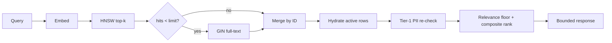

Reads are tenant- and agent-scoped. Durable search uses pgvector; the hot-cache path is optional. The forget route exists but is not an accepted public lifecycle contract.

::page-status{status="PROVISIONAL" verified="2026-10-21"}
::

## Search request

`POST /v1/memories/search` requires `memory:read` and accepts:

| Field | Rules |
| --- | --- |
| `agent_id` | Required; the agent scope is not inferred from a client body |
| `query` | 1–10,000 characters |
| `limit` | 1–50; default 10 |
| `min_similarity` | Optional 0–1; defaults to the configured ANN cutoff (0.70) |
| `min_confidence` | 0–1; default 0 |

The response returns `results[]`, each with the memory, its retrieval `similarity`, a `rank`, and a `source` of `vector` or `full_text`. `similarity` is the retrieval metric, not the final composite score:

- Vector: cosine similarity.
- Full text: `ts_rank_cd` clamped to `[0, 1]`.

The final order is a composite score, so a lower-similarity but much more recent, useful, or confident memory can outrank a stale near-match.

## Two-stage filtering

Do not confuse these thresholds:

| Stage | Default | Purpose |
| --- | --- | --- |
| ANN `min_similarity` | 0.70 | Drops vector candidates before hydration |
| Composite relevance floor | 0.15 | Drops candidates whose relevance component is below the floor before composite scoring |

Full-text hits have no cosine score. For composite scoring they use a fixed relevance sentinel of `0.5`; the HTTP `similarity` still reports `ts_rank_cd`. The relevance floor is constrained to stay below `0.5`, otherwise full-text hits would be mass-excluded.

## Retrieval flow



- The vector path sets `hnsw.ef_search` per transaction.
- Full-text fallback is controlled by `IBEX_MEMORY_SEARCH_FALLBACK_ENABLED` and only runs for a searchable query when vector hits are below the limit.
- Duplicate IDs keep the vector candidate.
- Only `status = active` and `deleted_at IS NULL` rows are returned.
- A read-path Tier-1 structured-PII re-check drops hits containing raw email, phone, SSN, credit-card, or IPv4 patterns rather than returning them.
- PostgreSQL is required for durable reads; Redis is not.

## Hot cache

`GET /v1/memories/hot` is a Redis sorted-set read, not semantic search. It returns the per-agent hot set ordered by the write-time composite score, with relevance fixed at `1.0` because no query exists at write time.

Keys are tenant-prefixed:

```text
{org_id}:memory:{memory_id}
{org_id}:hot_memories:{agent_id}
```

The hot set is capacity-bounded (50) and trimmed on write. The default read limit is 20. A Redis miss or outage must not widen scope; the durable PostgreSQL path remains the source of truth. Hot hits also pass the Tier-1 PII re-check.

## Scoring inputs

The composite uses five components with defaults:

| Component | Weight |
| --- | --- |
| Relevance | 0.40 |
| Recency | 0.25 |
| Usefulness | 0.20 |
| Confidence | 0.10 |
| Access frequency | 0.05 |

Recency uses category half-lives over the memory's `valid_from`, with the full label set when present. Access frequency is capped at 10 retrievals. These weights are policy inputs, not a claim of semantic correctness.

## Feedback

`POST /v1/memories/{memory_id}/feedback` records `positive`, `negative`, or `neutral` with scope validation. Feedback updates the usefulness score and refreshes the hot-cache entry. It is evidence about retrieval quality; it does not rewrite memory content or make a false memory true.

## Forget and tombstones

`POST /v1/memories/{memory_id}/forget` is a provisional GAP-007 contract. It requires the caller's expected lifecycle revision and writes a revision-fenced tombstone in one transaction.

A successful forget:

- Sets a tombstone and increments the lifecycle revision.
- Invalidates workers that captured the pre-forget source-session revision.
- Removes the hot-cache entry after the authoritative commit.
- Makes all reads, searches, feedback, dedup, and conflict candidate loads ignore the row.
- Rejects a stale expected revision instead of overwriting a newer lifecycle state.

::callout
---
{"type":"warning","title":"Not an accepted deletion contract"}
---

  The forget route is locally implemented but not accepted as a public lifecycle contract. Full-store deletion, projection fencing, restore behavior, and independent verification remain open.

::

## What the evidence supports

- HNSW and GIN index usage are exercised by integration tests.
- Cross-org, cross-agent, and inactive-row boundaries are tested.
- Revision-fenced forget and cache invalidation are covered by local tests.
- The D1/D2 operator read paths expose metadata only; raw memory content is not an operator shortcut.

## What it does not support

- A guarantee that every derived copy (cache, trace, analytic projection) is deleted at the same instant.
- Exactly-once projection effects across PostgreSQL and ClickHouse.
- A complete tenant-isolation proof for backups and archives.
- Semantic quality or hosted latency evidence for search ranking.
- A public lifecycle contract with checkpoints, provenance, and retention enforcement.

## Related

- [Memory writes](/docs/memory/write-path) — dedup, PII, conflict, and labels
- [Data lifecycle and deletion](/docs/operations/data-lifecycle-and-deletion) — purge, legal holds, and receipts
- [Context ranking and packing](/docs/context/ranking-and-packing) — how retrieved memories are packed
- [Tenant isolation](/docs/security/tenant-isolation) — cross-tenant read rules
