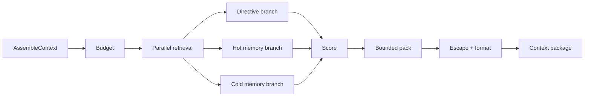

Context assembly converts directives and retrieved memories into a bounded prompt package. The pipeline exists locally. Caller authentication and the accepted deadline boundary are not complete, so the service is restricted to loopback or a trusted network boundary.

::page-status{status="PROVISIONAL" verified="2026-10-21" note="Caller authentication and deadline acceptance remain open"}
::

## Pages

- [Ranking and packing](/docs/context/ranking-and-packing) — retrieval deadlines, budget formula, scoring, DP/greedy packing, and formatting safety.

## Pipeline

1. **Budget** — model capability catalog and a character/rune estimate. This is not exact tokenizer accounting.
2. **Retrieve** — directive Redis, hot memory, and cold semantic memory run in parallel with independent failure handling.
3. **Score** — interim similarity and confidence scoring; category half-lives are applied by the memory substrate.
4. **Pack** — bounded dynamic-programming knapsack with a greedy fallback.
5. **Format** — deterministic order and nonce-delimited, escaped memory serialization.

`retrieval_wall_ms = min(timeout_ms, deadline_ms)`. The defaults are 45 ms for retrieval and 40 ms for the gRPC deadline.

## Security limitation

::callout
---
{"type":"danger","title":"No caller authentication"}
---

  The gRPC server has no auth interceptor. On a non-loopback bind it trusts request `org_id` and `agent_id`. Do not expose it to an untrusted network. A network address is not an authentication control.

::

Keep `IBEX_CONTEXT_GRPC_ADDR=127.0.0.1:<port>` unless a documented trusted-sidecar boundary exists. Do not claim caller authentication until the deferred interceptor lands.

## Failure behavior

| Failure | Result |
| --- | --- |
| Directive lookup fails | Continue with memory branches |
| Hot or cold memory fails | Continue with available branches |
| Retrieval exceeds wall budget | Return partial or fallback context |
| Packing cannot fit | Greedy fallback, still bounded |
| Context service unavailable | Proxy proceeds with directive-only behavior |

Context degradation is safe only if the caller cannot force cross-tenant retrieval. That is exactly why the auth limitation is called out above.

## Explicitly not implemented

- `SearchMemories` and `RecordMemoryFeedback` return `UNIMPLEMENTED`.
- Caller identity propagation from the proxy is not authenticated at the context boundary.
- The character estimate is not a provider-exact tokenizer.
- There is no accepted hosted latency or quality benchmark for this service.
