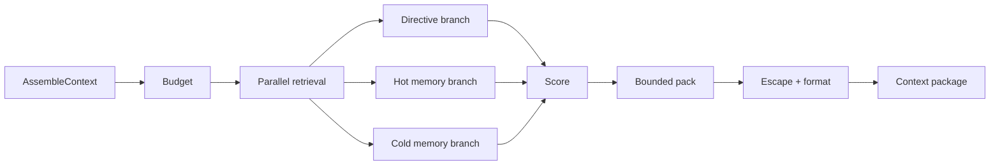

Context assembly converts directives and retrieved memories into a bounded prompt package. The pipeline exists locally. Every RPC requires a shared caller token, so unauthenticated access is closed; per-user authentication and the accepted deadline boundary are not complete, so the service stays on loopback.

::page-status{status="PROVISIONAL" verified="2026-11-05" note="Unauthenticated access is closed by a shared caller token; per-user authentication and deadline acceptance remain open"}
::

## Pages

- [Ranking and packing](/docs/context/ranking-and-packing) — retrieval deadlines, budget formula, scoring, DP/greedy packing, and formatting safety.

## Pipeline

1. **Budget** — model capability catalog and a character/rune estimate. This is not exact tokenizer accounting.
2. **Retrieve** — directive Redis, hot memory, and cold semantic memory run in parallel with independent failure handling.
3. **Score** — interim similarity and confidence scoring; category half-lives are applied by the memory substrate.
4. **Pack** — bounded dynamic-programming knapsack with a greedy fallback.
5. **Format** — deterministic order and nonce-delimited, escaped memory serialization.

`retrieval_wall_ms = min(timeout_ms, deadline_ms)`. The defaults are 45 ms for retrieval and 40 ms for the gRPC deadline.

## Security boundary

::callout
---
{"type":"warning","title":"Caller authentication, not per-user authentication"}
---

  Every RPC requires exactly one `x-ibex-context-service-token` metadata entry matching the server's `IBEX_CONTEXT_GRPC_SERVICE_TOKEN`, and `principal_context` must be present with an `org_id` and `agent_id` equal to the request selectors. The server refuses to start without a token and refuses any non-loopback bind. **Unauthenticated access is closed.** The token is a shared secret and the principal is unsigned, so **a token holder can still assert any principal**. Tenant isolation remains a proxy-side property, not a property of this service.

::

Keep `IBEX_CONTEXT_GRPC_ADDR=127.0.0.1:<port>`. There is no TLS, no principal signing, and no per-user validation at this boundary, and rotating the token is a coordinated restart of the proxy and the context server. Do not claim per-user authentication or tenant isolation at the context service.

## Failure behavior

| Failure | Result |
| --- | --- |
| Directive lookup fails | Continue with memory branches |
| Hot or cold memory fails | Continue with available branches |
| Retrieval exceeds wall budget | Return partial or fallback context |
| Packing cannot fit | Greedy fallback, still bounded |
| Missing, duplicate, or wrong service token | `UNAUTHENTICATED`; the proxy falls back to directive-only with `X-IBEX-Context-Fallback: true` |
| Selectors disagree with the principal | `PERMISSION_DENIED`; the proxy falls back; zero downstream calls |
| Context service unavailable | Proxy proceeds with directive-only behavior |

Context degradation is a quality change, not an authorization change: the caller-token and selector checks run before any directive or memory read, so a failed assembly cannot widen visibility.

## Explicitly not implemented

- `SearchMemories` and `RecordMemoryFeedback` return `UNIMPLEMENTED` after authentication.
- The service token authenticates the caller, not the user; `PrincipalContext` is unsigned and per-user validation at this boundary is not implemented.
- The character estimate is not a provider-exact tokenizer.
- There is no accepted hosted latency or quality benchmark for this service.
