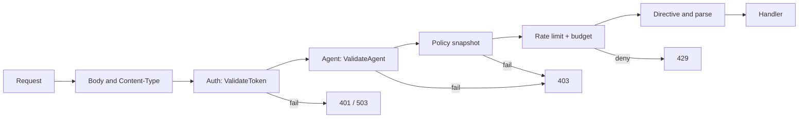

::page-status{status="IMPLEMENTED" verified="2026-10-21"}
::

Every protected proxy request passes through token validation and agent identity verification before the handler runs. The proxy delegates to the auth service over gRPC — it never stores token hashes locally. For service responsibilities and token issuance, see the [Auth service docs](/docs/auth/overview).

::callout
---
{"type":"warning","title":"Fail closed"}
---

  Auth or agent verification failures deny the request. There is no anonymous fallback on protected routes. Auth gRPC outage returns **503** `AUTH_UNAVAILABLE`, not passthrough.

::

## Token types

IBEX Harness supports several token classes. Each has a different risk profile and rotation policy.

| Type | Lifetime | Typical use | Storage / verification |
| --- | --- | --- | --- |
| Personal Access Token (PAT) | Until revoked or expired | SDK, proxy, service integrations | Argon2id hash in Postgres |
| Operator session (JWT) | 15 min access, 7 day refresh, 5 min step-up | Console operator UI | RS256 access/refresh JWTs; session and JTI revocation in Postgres |

There is no separate "service token" or marketplace credential class in the shipped auth contract. Do not invent one in client configuration. Provider API keys are a distinct secret type sealed by auth and resolved by the proxy under `SecretUse`.

::callout
---
{"type":"tip","title":"Where credentials are issued"}
---

  The auth HTTP surface is health, readiness, and metrics only. Token, operator-session, TOTP, and provider-credential operations are gRPC methods (plus management routing in `services/api`). See [Auth overview](/docs/auth/overview).

::

## Proxy middleware order

Protected chat routes run the relevant middleware in this order:



::steps

### Token validation

    gRPC `ValidateToken` resolves org_id and permission bitmap from the bearer token. Invalid, expired, or revoked tokens return **401**.
  
### Agent identity

    gRPC `ValidateAgent(agent_id, org_id_from_token)` requires header `X-IBEX-Agent-ID`. Cross-org or inactive agents return **403** (`AGENT_NOT_AUTHORIZED`), never **404**.
  
### Rate limit

    Org-level RPM via shared Redis. An exhausted quota returns 429; Redis dependency failure returns 503 and does not proceed to a provider, per [ADR-0081](https://github.com/Rick1330/ibex-harness/blob/main/engineering/adr/0081-fail-closed-proxy-runtime-controls.md).
  
::

## Required headers

| Name | Type | Required | Description |
| --- | --- | --- | --- |
| `Authorization` | `string` | Yes | Bearer token — PAT issued by auth service CreateToken. |
| `X-IBEX-Agent-ID` | `uuid` | Yes | Calling agent UUID; must belong to the token org. Chat does not take an org from the URL. |
| `Content-Type` | `string` | Yes | application/json on POST bodies with a JSON payload. |

## Probe a protected route

::tabs

:::tabs-item{label="curl"}

```bash
curl -s -w "\nHTTP %{http_code}\n" \
  -X POST "http://localhost:8080/v1/chat/completions" \
  -H "Authorization: Bearer ${IBEX_DEV_TOKEN}" \
  -H "X-IBEX-Agent-ID: ${IBEX_DEV_AGENT_ID}" \
  -H "Content-Type: application/json" \
  -d '{"model":"gpt-4o","messages":[{"role":"user","content":"ping"}]}'
```
  
:::

:::tabs-item{label="PowerShell"}

```powershell
$headers = @{
  Authorization = "Bearer $env:IBEX_DEV_TOKEN"
  "X-IBEX-Agent-ID" = $env:IBEX_DEV_AGENT_ID
  "Content-Type" = "application/json"
}
Invoke-RestMethod -Method POST `
  -Uri "http://localhost:8080/v1/orgs/$env:IBEX_DEV_ORG_ID/chat/completions" `
  -Headers $headers `
  -Body '{"model":"gpt-4o","messages":[{"role":"user","content":"ping"}]}'
```
  
:::

::

Mock-mode expected: **200** for registered models. `501 PROVIDER_NOT_CONFIGURED` means the model is not registered — auth and agent checks already passed.

## Error responses

| HTTP | Code | Meaning |
| --- | --- | --- |
| 401 | `MISSING_TOKEN`, `INVALID_TOKEN` | No bearer or token not valid |
| 403 | `AGENT_NOT_AUTHORIZED`, `INSUFFICIENT_PERMISSIONS` | Agent wrong org or missing permission bit |
| 503 | `AUTH_UNAVAILABLE`, `SERVICE_DEGRADED` | Auth gRPC unreachable or degraded |

All errors use the stable JSON envelope documented in [Errors](/docs/api-reference/errors).

## Authorization model

Permissions use a 64-bit bitmap ([ADR-0009](https://github.com/Rick1330/ibex-harness/blob/main/engineering/adr/0009-permission-bitmap.md)). The `ProxyChatCompletion` set is `MemoryRead | SessionCreate | SessionRead | SecretUse`; `SecretUse` is required because the proxy may resolve a sealed provider credential. Token create/revoke requires explicit `TokenCreate` / `TokenRevoke` bits.

::callout
---
{"type":"note","title":"Authentication ≠ authorization"}
---

  A valid token does not imply access to every resource in the org. Endpoints declare required permissions. Proxy identity mismatches return 403; management and memory resource lookups use 404 where existence leakage matters.

::

## Local dev timeout

Argon2 verify on developer machines can exceed the production 50ms auth budget. If smoke tests return **503**, increase the validate timeout:

```bash
IBEX_AUTH_VALIDATE_TIMEOUT=2s go run ./services/proxy/cmd/proxy
```

See [Troubleshooting](/docs/operations/troubleshooting) for migration and compose-dev issues.

## Related

- [Issuing API keys](/docs/auth/issuing-api-keys)
- [Proxy authentication](/docs/proxy/authentication)
- [ADR-0011: Proxy auth client](https://github.com/Rick1330/ibex-harness/blob/main/engineering/adr/0011-proxy-auth-client.md)
- [ADR-0016: Agent identity verification](https://github.com/Rick1330/ibex-harness/blob/main/engineering/adr/0016-agent-identity-verification.md)
