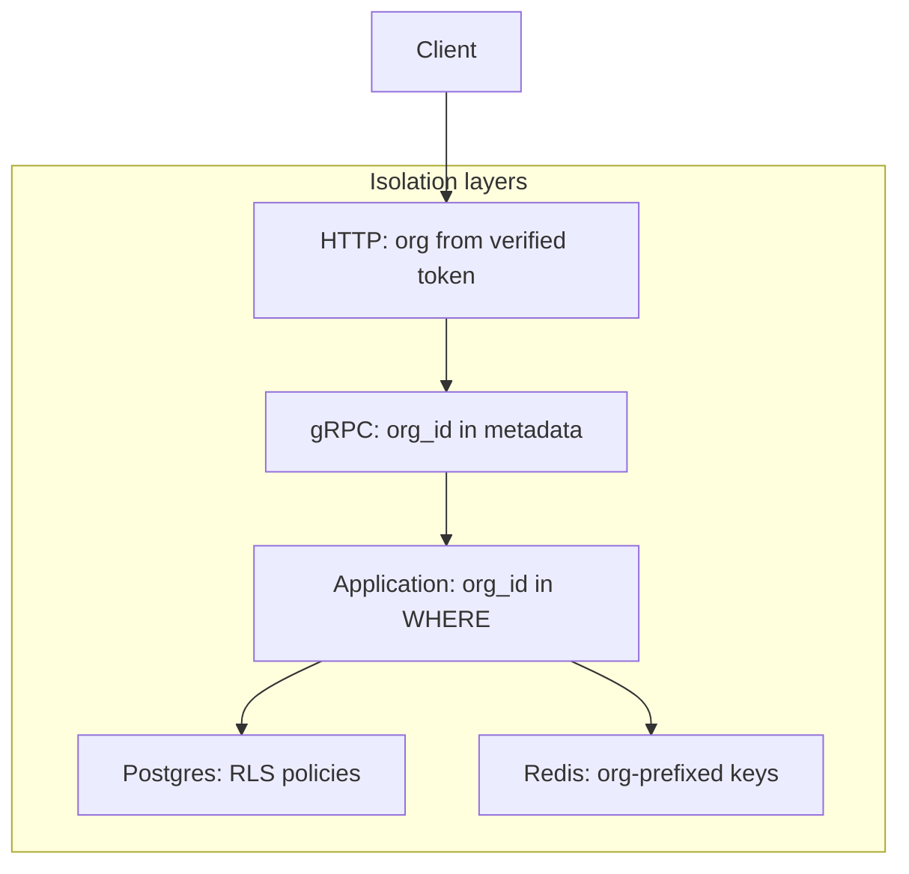

::page-status{status="PROVISIONAL" verified="2026-10-21" note="Full tenant-isolation proof remains open"}
::

Org A must never read or mutate Org B's data — via API, Postgres, Redis, logs, or analytics. IBEX Harness enforces isolation at multiple layers so a single regression cannot bypass tenancy. Coverage is broad but not yet proven end to end for every surface; see the [gap register](https://github.com/Rick1330/ibex-harness/blob/main/engineering/architecture-v2/18-gap-register.md).

::callout
---
{"type":"danger","title":"P1 incident"}
---

  Any suspected cross-tenant data leak is severity P1. Freeze deploys, enable enhanced audit logging, and follow the [incident response runbook](/docs/operations/incident-response).

::

## Defense in depth



Each layer is independent. If RLS is misconfigured, application queries still filter by org. If application code regresses, RLS denies cross-tenant rows.

## PostgreSQL row-level security

Every tenant table in `ibex_core` includes `org_id`. RLS policies enforce:

```sql
org_id = current_setting('app.current_org_id')::uuid
```

::steps

### Set org context per transaction

    Every request runs `SET LOCAL app.current_org_id = '{org_id}'` inside a transaction scope — never globally on the pooled connection.
  
### Fail closed on missing context

    If org context cannot be set, the operation is denied rather than running unscoped queries.
  
### Verify policies in dev

    After `make db-migrate`, confirm RLS is enabled on core tables.
  
::

### Protected table groups

| Group | Representative tables |
| --- | --- |
| Identity | `organizations`, `users`, `agents`, `tokens`, `provider_credentials` |
| Conversation | `sessions`, `checkpoints`, `directives`, `directive_versions` |
| Memory | `memories`, `memory_labels`, `memory_relationships`, `memory_feedback` |
| Evidence | `evidence_runs`, `evidence_spans`, `evidence_events`, `evidence_outbox` |
| Privacy | `privacy_audit_ledger`, `legal_holds`, `org_capture_policies` |
| Billing config | `budget_periods`, `rate_cards`, `enforcement_decisions` |

See [Multi-tenant RLS](/docs/auth/multi-tenant-rls) for migration and verification commands.

::callout
---
{"type":"warning","title":"Use SET LOCAL, not SET"}
---

  `SET app.current_org_id` without `LOCAL` can leak org context across pooled connections. Always scope context to the current transaction.

::

## Application layer

Even with RLS enabled, every store query includes `org_id` in the WHERE clause:

- Makes intent obvious in code review
- Reduces blast radius if a policy is disabled during migration
- Required for services that do not yet have RLS (ClickHouse)

Error semantics depend on the surface:

- Proxy identity checks return **403** for an agent that does not belong to the token organization.
- Management and memory resource lookups return **404** for unknown or out-of-tenant identifiers so the response is not an existence oracle.
- Do not use a blanket rule. Apply the semantics of the owning API and test both directions.

## Redis namespacing

Redis carries rate limits, cache entries, broker state, and result backends for Go and Python services. Tenant-bearing keys must include `org_id` as a segment:

| Purpose | Pattern |
| --- | --- |
| Rate limit | `ratelimit:{org_id}:rpm:{unix_minute}` |
| Hierarchical rate limit | `ratelimit:{org_id}:agent:{agent_id}:rpm:{unix_minute}` |
| MCP runtime | `ratelimit:{org_id}:{scope}:{minute}` |

Global keys are allowed only for explicitly labeled shared metadata, such as a token-hash lookup or revocation broadcast. Never store tenant payload under a global key. Redis logical databases are separated by purpose: cache `0`, broker `1`, rate limit `2`, results `3`.

## ClickHouse and analytics

ClickHouse has no row-level security. Every query must include an explicit `org_id` filter.

::callout
---
{"type":"warning","title":"No global ClickHouse enforcement switch"}
---

  There is **no** application-wide `CLICKHOUSE_ORG_FILTER_ENFORCEMENT` guard. The real defenses are narrower:

- `packages/clickhouse/validate.go` rejects an empty `org_id` before executing a query.
- `packages/usagequery/ast.go` requires an organization predicate in generated usage queries.
- Each hand-written query must carry its own `org_id` predicate.

  Do not describe ClickHouse isolation as globally enforced until a cross-cutting guard is actually implemented and tested.

::

Per-org breakdowns belong in ClickHouse analytics, not Prometheus labels — high-cardinality labels like `org_id` are forbidden on metrics ([ADR-0021](https://github.com/Rick1330/ibex-harness/blob/main/engineering/adr/0021-prometheus-metric-catalog.md)).

## Audit isolation

Audit logs are append-only and org-scoped at the application layer. Cross-tenant access attempts (should be impossible) emit audit warnings for forensic analysis.

## Verification checklist

::process-steps
---
{"steps":[{"title":"Integration tests","description":"Cross-org reads must return empty, 403, or 404 according to the owning API — never another org's rows. CI covers the proxy auth boundary; memory, API, MCP, and Console need their own negative tests."},{"title":"RLS enabled","description":"pg_tables shows rowsecurity = true on ibex_core tenant tables after migrations."},{"title":"Redis key review","description":"New cache or rate-limit keys include org_id; no tenant payload under global prefixes."},{"title":"Error semantics","description":"Proxy agent/token mismatch is 403; management and memory resource lookups are 404 to avoid existence leaks. Test the surface you changed."}]}
---
::

## Related

- [Auth org and project model](/docs/auth/org-project-model)
- [ADR-0005: Postgres migration strategy](https://github.com/Rick1330/ibex-harness/blob/main/engineering/adr/0005-postgres-migration-strategy.md)
- [Security overview](/docs/security/overview)
