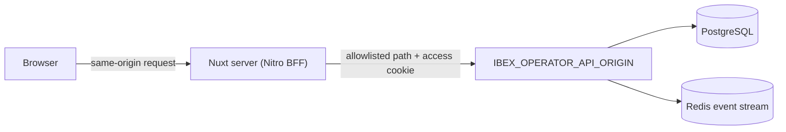

`services/console` is the canonical operator application. It is a Nuxt 4 server-rendered app with a same-origin Nitro
BFF. `services/dashboard` is a temporary compatibility shell and must not become a second Track D product.

::page-status{status="PROVISIONAL" verified="2026-11-01" note="4 of 10 core surfaces are live; 6 core and 8 platform-tier surfaces are preview designs"}
::

The Console is the operations plane for the memory/context lifecycle (ADR-0089): agents, sessions, memories, evidence,
directives, policies, trace exploration, platform health, and settings. Incidents, drift, audit, budgets, analytics,
providers, MCP tools, and access are a separate **platform tier** and are hidden from the default navigation.

A route existing in the Console is not evidence that its data is live. A preview surface renders labelled illustrative
fixtures under ADR-0089 §4 and makes no live claim. A live surface fails closed instead of falling back to fixtures.

`Live` describes the read path: the surface calls its owning contract through the BFF and renders real data. It is not
an acceptance claim. Every live Console row remains `PROVISIONAL` in the status ledger; preview rows remain `DEFERRED`
until an owning contract exists, and platform-tier rows also need a named design partner.

## Surface status

`services/console/shared/operator/surfaces.ts` is the machine-readable source of truth.
`pnpm --filter @ibex/console check:surfaces` asserts README row, status, and tier parity, and that this page, the site
ledger, and the engineering ledger agree on the core live, core preview, and platform-tier counts.

### Core tier — the memory/context lifecycle

| Surface | Route | Status | Boundary |
| --- | --- | --- | --- |
| Overview | `/` | Live D1 | Tenant-scoped organization snapshot; no fixture fallback |
| Agents | `/agents` | Live D2 | Tenant-scoped inventory and detail from `operator.agents.v1`; no fixture fallback |
| Sessions | `/sessions` | Preview | Session timeline and inspector; no session read model or turn-to-trace join is connected |
| Memories | `/memories` | Preview | Memory index, provenance, and conflicts; no operator read model is connected |
| Evidence | `/evidence` | Preview | Certification coverage, tombstones, and relay chain; no summary contract is connected |
| Directives | `/directives` | Preview (deferred) | Version timeline and diff; no owning API router exists |
| Policies | `/policies` | Preview | Snapshots, readable rules, and diffs; run-to-policy provenance is not connected |
| Explore | `/explore` | Live D2 | Metadata-only trace list, multi-run view, and validated run detail |
| Platform | `/platform` | Live D1 | Dependency health, ingestion lag, retention, backup, restore, and deployment evidence |
| Settings | `/settings` | Preview | Illustrative configuration only; no write path, owner attestation, or audit link is connected |

### Platform tier — hidden from default navigation

Incidents, drift, audit log, budgets, analytics, providers, MCP tools, and access remain designed previews. They are
reachable through the sidebar's "Platform tier" disclosure and carry a persistent tier banner. Promoting one requires a
named design partner, an owning contract, and a superseding ADR.

## Route map

| Route family | Current behavior |
| --- | --- |
| `/` | Overview; D1 live only when an operator session and upstream origin are configured |
| `/explore`, `/explore/t/{traceId}`, `/explore/r/{runId}` | Metadata trace list, multi-run trace view, and run detail |
| `/agents`, `/agents/{agentId}` | Live D2 agent inventory and detail from `operator.agents.v1` |
| `/sessions`, `/memories`, `/evidence`, `/directives`, `/policies`, `/settings` | Core-tier preview designs; list and detail routes exist but are not accepted live products |
| `/incidents`, `/drift`, `/audit`, `/budgets`, `/analytics`, `/providers`, `/mcp-tools`, `/access` | Platform-tier preview designs |
| `/dashboard`, `/dashboard/*` | Permanent redirects to the approved top-level routes |
| Unknown legacy paths | `404` |

## Data boundary



- Browser code never receives upstream credentials or tenant authority.
- The server builds URLs from a fixed path allowlist, not a request-supplied URL.
- The upstream origin must be an origin only: no path, query, fragment, or userinfo. HTTP and HTTPS are accepted for the origin; a request carrying a session cookie requires HTTPS.
- Redirects are disabled, JSON responses are parsed against runtime Zod schemas, and the default request timeout is 5 seconds.
- Responses use `Cache-Control: private, no-store` and `Vary: Cookie`.
- The SSE bridge is same-origin checked, forwards only the configured access cookie, allowlists `/v1/operator/events/stream`, caps `Last-Event-ID` to digits, and streams with buffering disabled.
- Hostile memory, Markdown, HTML, links, prompts, and tool content must remain inert or sanitized.

Presentation flags are not authority. The Console exposes no mutation routes, so read-only behavior is structural rather
than flag-gated. `CONSOLE_READ_ONLY` is reserved and is not consulted by the Nuxt implementation.

## Configuration

| Variable | Meaning |
| --- | --- |
| `IBEX_OPERATOR_API_ORIGIN` | Server-only approved upstream origin for operator reads |
| `IBEX_OPERATOR_SESSION_COOKIE_NAME` | Access-session cookie name; defaults to `ibex_session` |
| `NUXT_PUBLIC_IBEX_ENV` | Environment label shown in the console chrome |

There is no production preview-data mode. The only fixture substitution is compile-time `import.meta.dev`, which
renders an `Illustrative` provenance chip and never activates in a production build. Never put a bearer token,
AuthService secret, organization ID, or arbitrary upstream URL authority in browser-exposed configuration.

## Run locally

```bash
pnpm install --frozen-lockfile --ignore-scripts
pnpm --filter @ibex/console dev
```

Open `/`. Live reads require `IBEX_OPERATOR_API_ORIGIN` and an operator session cookie; without them, live surfaces show
an explicit unavailable state. For verification:

```bash
pnpm --filter @ibex/console test
pnpm --filter @ibex/console check:surfaces
pnpm --filter @ibex/console typecheck
pnpm --filter @ibex/console lint
pnpm --filter @ibex/console build
pnpm --filter @ibex/console test:e2e
```

A passing local run is not hosted deployment evidence.

## Readiness gaps

- No login route or demo credentials.
- AuthService-backed sessions, secure-cookie policy, MFA, CSRF-protected mutations, and exact credentialed CORS are not accepted end to end.
- Deployment origin, rollback, reconnect, and availability evidence are missing.
- Two-tenant negative evidence for the live slice is incomplete.
- Raw trace content, replay, export, and operator actions have no accepted owning API contract.
- Six core surfaces and eight platform-tier surfaces remain preview designs. Preview coverage is not a substitute for live contract tests.

Any expansion beyond the current slice must add an owning API contract, tenant-negative tests, redaction and
hostile-content tests, accessibility checks, performance evidence, and a rollback plan before changing the status
ledger.

## Related

- [Operator sessions](/docs/auth/operator-sessions) — cookie, RS256, CSRF, and step-up mechanics
- [Management API](/docs/api-reference/management-api) — D1/D2 route contracts
- [Console and operator topology](/docs/architecture/target-architecture) — target boundaries
- [Traces and ClickHouse](/docs/operations/traces-and-clickhouse) — analytics versus canonical metadata
- [Tenant isolation](/docs/security/tenant-isolation) — cross-tenant read rules
