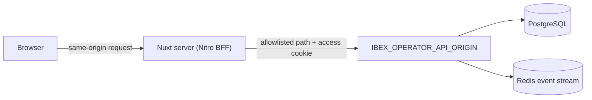

`services/console` is the canonical operator application. It is a Nuxt 4 server-rendered app with a same-origin Nitro
BFF. The dashboard compatibility shell was retired by ADR-0090.

::page-status{status="PROVISIONAL" verified="2026-11-19" note="8 of 10 core surfaces are live; 2 core surfaces and 8 platform-tier surfaces are preview designs"}
::

The Console is the operations plane for the memory/context lifecycle (ADR-0089): agents, sessions, memories, evidence,
directives, policies, trace exploration, platform health, and settings. Incidents, drift, audit, budgets, analytics,
providers, MCP tools, and access are a separate **platform tier** and are hidden from the default navigation.

A route existing in the Console is not evidence that its data is live. A preview surface renders labelled illustrative
fixtures under ADR-0089 §4 and makes no live claim. A live surface fails closed instead of falling back to fixtures.

`Live` describes the read path: the surface calls its owning contract through the BFF and renders real data. It is not
an acceptance claim. Every live Console row remains `PROVISIONAL` in the status ledger; preview rows remain `DEFERRED`
until an owning contract exists, and platform-tier rows also need a named design partner.

## Session

The Console has a session. `app/pages/login.vue` posts a personal access token once, in the request body, to
`POST /api/operator/session/login`; the BFF relays the API's `Set-Cookie` headers, so the browser then holds an HttpOnly
access cookie, an HttpOnly refresh cookie, and a JavaScript-readable CSRF cookie. The token is never placed in a URL,
in storage, or in a log.

- Rotation is server-side and single-use: an expired access cookie is refreshed on the next read through
  `POST /api/operator/session/refresh`, concurrent reads share one rotation, and a replayed refresh token revokes the
  whole session family.
- The cookie-authenticated session routes require the double-submit `X-CSRF-Token`, and refresh and logout apply the
  API's `Origin`/`Referer` rule. Login has no prior token, so the BFF rejects a cross-origin login itself.
- `app/pages/logout.vue` revokes the session upstream and clears the cookies before returning to `/login`.

`services/console/e2e/login-journey.spec.ts` starts from an empty cookie jar and drives login, a live read, a server-side
rotation, and logout, and separately covers a rejected token, a replayed refresh token, and the origin rule. Its upstream
is the loopback stand-in, which implements the API's session rules rather than bypassing them: this is local evidence,
not hosted acceptance.

Every operator **data** route is still a read. The three session routes are the only cookie mutations, so operator
actions still cannot mutate state (`P0-05`).

## Surface status

`services/console/shared/operator/surfaces.ts` is the machine-readable source of truth.
`pnpm --filter @ibex/console check:surfaces` asserts README row, status, and tier parity, and that this page, the site
ledger, and the engineering ledger agree on the core live, core preview, and platform-tier counts.

### Core tier — the memory/context lifecycle

| Surface | Route | Status | Boundary |
| --- | --- | --- | --- |
| Overview | `/` | Live D1 | Tenant-scoped organization snapshot; no fixture fallback |
| Agents | `/agents` | Live D2 | Tenant-scoped inventory and detail from `operator.agents.read.v1`; no fixture fallback |
| Sessions | `/sessions` | Live D3 | Metadata-only session index and turn-to-trace ledger from `operator.sessions.read.v1` |
| Memories | `/memories` | Live D2 | Metadata-only index from `operator.memories.read.v1`; content is not exposed |
| Evidence | `/evidence` | Live D2 | Capture completeness and relay delivery from `operator.evidence.summary.v1`; tombstone propagation, receipted erasure jobs, and audit-chain continuity from `operator.evidence.deletions.v1`. Field-level redaction is explicitly unavailable |
| Directives | `/directives` | Live D5 | Version timeline, the live pointer, and per-version session usage from `operator.directives.read.v1` and `operator.directives.get.v1`; instruction text, diffs, and promotion history are explicitly unavailable |
| Policies | `/policies` | Preview | Snapshots, readable rules, and diffs; run-to-policy provenance is not connected |
| Explore | `/explore` | Live D2 | Metadata-only trace list, multi-run view, and validated run detail |
| Platform | `/platform` | Live D1 | Dependency health, ingestion lag, retention, backup, restore, and deployment evidence |
| Settings | `/settings` | Preview | Illustrative configuration only; no write path, owner attestation, or audit link is connected |

### Platform tier — hidden from default navigation

Incidents, drift, audit log, budgets, analytics, providers, MCP tools, and access remain designed previews. They are
reachable through the sidebar's "Platform tier" disclosure and carry a persistent tier banner. Promoting one requires a
named design partner, an owning contract, and a superseding ADR.

## Route map

| Route family | Current behavior |
| --- | --- |
| `/` | Overview; D1 live only when an operator session and upstream origin are configured |
| `/login`, `/logout` | Session pages. `/login` exchanges a personal access token once for cookies; `/logout` revokes the session upstream and returns to `/login` |
| `/explore`, `/explore/t/{traceId}`, `/explore/r/{runId}` | Metadata trace list, multi-run trace view, and run detail |
| `/agents`, `/agents/{agentId}` | Live D2 agent inventory and detail from `operator.agents.read.v1` |
| `/memories`, `/memories/{memoryId}` | Live D2 metadata-only memory index and detail from `operator.memories.read.v1` |
| `/sessions`, `/sessions/{sessionId}` | Live D3 metadata-only session index and turn-to-trace detail from `operator.sessions.read.v1` |
| `/evidence`, `/directives` | Live D2 evidence summary and D5 directive version timeline; no mutation route on either surface |
| `/policies`, `/settings` | Core-tier preview designs; list and detail routes exist but are not accepted live products |
| `/incidents`, `/drift`, `/audit`, `/budgets`, `/analytics`, `/providers`, `/mcp-tools`, `/access` | Platform-tier preview designs |
| `/dashboard`, `/dashboard/*` | Permanent redirects to the approved top-level routes |
| Unknown legacy paths | `404` |

## Data boundary



- Browser code never receives upstream credentials or tenant authority.
- The server builds URLs from a fixed path allowlist, not a request-supplied URL.
- Operator data routes forward only the access cookie. The three session routes relay the API's `Set-Cookie` headers and, on refresh and logout, carry the refresh and CSRF cookies, which never cross a read path.
- The upstream origin must be an origin only: no path, query, fragment, or userinfo. HTTP and HTTPS are accepted for the origin; a request carrying a session cookie requires HTTPS.
- Redirects are disabled, JSON responses are parsed against runtime Zod schemas, and the default request timeout is 5 seconds.
- Responses use `Cache-Control: private, no-store` and `Vary: Cookie`.
- The SSE bridge is same-origin checked, forwards only the configured access cookie, allowlists `/v1/operator/events/stream`, caps `Last-Event-ID` to digits, and streams with buffering disabled.
- Hostile memory, Markdown, HTML, links, prompts, and tool content must remain inert or sanitized.

Presentation flags are not authority. Every operator **data** route is a read, so read-only behavior is structural rather
than flag-gated: the only cookie-mutating routes are the three session BFF routes (login, logout, refresh).
`CONSOLE_READ_ONLY` is reserved and is not consulted by the Nuxt implementation.

## Configuration

| Variable | Meaning |
| --- | --- |
| `IBEX_OPERATOR_API_ORIGIN` | Server-only approved upstream origin for operator reads |
| `IBEX_OPERATOR_SESSION_COOKIE_NAME` | Access-session cookie name; defaults to `ibex_session` |
| `IBEX_OPERATOR_REFRESH_COOKIE_NAME` | Refresh-cookie name; defaults to `ibex_refresh` |
| `IBEX_OPERATOR_CSRF_COOKIE_NAME` | CSRF double-submit cookie name; defaults to `ibex_csrf` |
| `NUXT_PUBLIC_IBEX_ENV` | Environment label shown in the console chrome |

There is no production preview-data mode. The only fixture substitution is compile-time `import.meta.dev`, which
renders an `Illustrative` provenance chip and never activates in a production build. Never put a bearer token,
AuthService secret, organization ID, or arbitrary upstream URL authority in browser-exposed configuration.

## Run locally

```bash
pnpm install --frozen-lockfile --ignore-scripts
pnpm --filter @ibex/console dev
```

Open `/login` and exchange a personal access token for a session. Live reads require `IBEX_OPERATOR_API_ORIGIN` and the
session cookie that login issues; without a session, live surfaces show an explicit sign-in state, and without an origin
they show an explicit unavailable state. For verification:

```bash
pnpm --filter @ibex/console test
pnpm --filter @ibex/console check:surfaces
pnpm --filter @ibex/console typecheck
pnpm --filter @ibex/console lint
pnpm --filter @ibex/console build
pnpm --filter @ibex/console test:e2e
```

A passing local run is not hosted deployment evidence.

## Readiness gaps

- No demo credentials: sign-in requires a personal access token.
- The session routes sit behind a default-off API operator feature switch, and hosted end-to-end acceptance, MFA and step-up, and exact credentialed CORS are still missing. Secure-cookie policy, single-use refresh rotation, family revocation, and the CSRF double-submit are covered by the local clean-browser journey, not by a hosted deployment.
- Deployment origin, rollback, reconnect, and availability evidence are missing.
- Two-tenant negative evidence for the live slice is incomplete.
- Raw trace content, replay, export, and operator actions have no accepted owning API contract.
- Two core surfaces and eight platform-tier surfaces remain preview designs. Preview coverage is not a substitute for live contract tests.

Any expansion beyond the current slice must add an owning API contract, tenant-negative tests, redaction and
hostile-content tests, accessibility checks, performance evidence, and a rollback plan before changing the status
ledger.

## Related

- [Operator sessions](/docs/auth/operator-sessions) — cookie, RS256, CSRF, and step-up mechanics
- [Management API](/docs/api-reference/management-api) — D1/D2 route contracts
- [Console and operator topology](/docs/architecture/target-architecture) — target boundaries
- [Traces and ClickHouse](/docs/operations/traces-and-clickhouse) — analytics versus canonical metadata
- [Tenant isolation](/docs/security/tenant-isolation) — cross-tenant read rules
