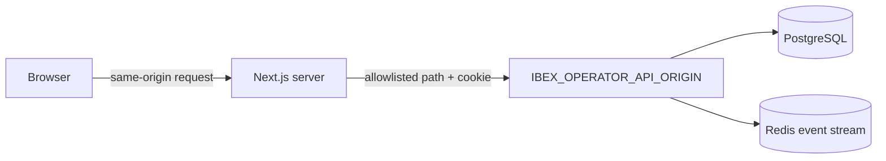

`services/console` is the canonical operator application. `services/dashboard` is a temporary compatibility shell and must not become a second Track D product.

::page-status{status="PROVISIONAL" verified="2026-10-21" note="Presentation and two read slices are mounted; login and mutations are deferred"}
::

A route existing in the Console is not evidence that its data is live. The shell deliberately renders preview fixtures or explicit unavailable states for surfaces without an owning API contract.

## Surface status

| Surface | Status | Boundary |
| --- | --- | --- |
| Shell, navigation, themes, responsive layout, cards, charts, tables, dialogs | Implemented presentation | May use fixtures; presentation is not a data claim |
| Server-only transport, request-time `no-store`, opt-in live mode | Mounted-but-provisional | Server may call only the configured upstream origin |
| D1 context/overview and platform health/event stream | Mounted-but-provisional | Read-only; hosted session/origin/reconnect evidence open |
| D2 Explore trace metadata list/detail | Mounted-but-provisional | Live mode plus read-only flag; no raw prompts or tool args |
| Login, signup, TOTP enrollment, token issuance, invites, mutations | Deferred | AuthService owns these flows; no demo credentials |
| Sessions, memories, directives, incidents, drift, analytics, billing, settings, replay, export | Preview/deferred | Owning APIs, permissions, audit, and acceptance are not claimed |

## Route map

| Route family | Current behavior |
| --- | --- |
| `/dashboard`, `/dashboard/overview` | Overview workbench; D1 live only when configured |
| `/dashboard/explore`, `/dashboard/explore/t/{traceId}`, `/dashboard/explore/r/{runId}` | Metadata trace list, multi-run trace view, and run detail |
| `/dashboard/agents`, `/dashboard/directives`, `/dashboard/sessions`, `/dashboard/memories` | Preview presentation; list/detail routes exist but are not accepted live products |
| `/dashboard/incidents`, `/dashboard/drift`, `/dashboard/analytics`, `/dashboard/billing`, `/dashboard/settings` | Preview/deferred |
| `/deferred` | Explicit unavailable surface |

The route tree is intentionally broader than the accepted data plane. Use the surface table, not the presence of a page, to determine whether a view is live.

## Data boundary



- Browser code never receives upstream credentials or tenant authority.
- The server builds URLs from a fixed path allowlist, not a request-supplied URL.
- The upstream origin must be an origin only: no path, query, fragment, or userinfo. HTTP and HTTPS are accepted for the origin; a request carrying a session cookie requires HTTPS.
- Redirects are disabled, JSON responses are parsed against runtime schemas, and the default request timeout is 5 seconds.
- Responses use `Cache-Control: no-store`.
- The SSE bridge is same-origin checked, forwards only the configured access cookie, allowlists `/v1/operator/events/stream`, caps `Last-Event-ID` to digits, and streams with buffering disabled.
- Hostile memory, Markdown, HTML, links, prompts, and tool content must remain inert or sanitized.

`CONSOLE_DATA_MODE=preview|live` is not authentication. `CONSOLE_READ_ONLY=1` is required for the current D2 live slice. Presentation flags are never authority. Legacy `OPERATOR_WEB_*` names are migration aliases only.

## Configuration

| Variable | Meaning |
| --- | --- |
| `CONSOLE_DATA_MODE` | `preview` or opt-in `live`; not authentication |
| `CONSOLE_READ_ONLY` | Must remain `1` for the current live slice |
| `IBEX_OPERATOR_API_ORIGIN` | Server-only approved upstream origin |
| `IBEX_OPERATOR_SESSION_COOKIE_NAME` | Optional access-cookie name; default `ibex_session` |
| `CONSOLE_PREVIEW` / `NEXT_PUBLIC_CONSOLE_PREVIEW` | Presentation flags; never tenant authority |

Never put a bearer token, AuthService secret, organization ID, or arbitrary upstream URL authority in browser-exposed configuration. Browser preferences may use local/session storage or a non-auth layout cookie; none is a credential store.

## Run locally

```bash
pnpm install --frozen-lockfile --ignore-scripts
pnpm --filter @ibex/console dev
```

Open `/dashboard`. Preview mode is explicitly opt-in and is disabled in production. For verification:

```bash
pnpm --filter @ibex/console test
pnpm --filter @ibex/console typecheck
pnpm --filter @ibex/console lint
pnpm --filter @ibex/console build
```

The browser end-to-end specs include boundary checks and the D1 live slice; a passing local run is not hosted deployment evidence.

## Readiness gaps

- No login route or demo credentials.
- AuthService-backed sessions, secure-cookie policy, MFA, CSRF-protected mutations, and exact credentialed CORS are not accepted end to end.
- Deployment origin, rollback, reconnect, and availability evidence are missing.
- Two-tenant negative evidence for the live slice is incomplete.
- Raw trace content, replay, export, and operator actions have no accepted owning API contract.
- Preview fixture coverage is not a substitute for live contract tests.

Any expansion beyond the current slice must add an owning API contract, tenant-negative tests, redaction/hostile-content tests, accessibility checks, performance evidence, and a rollback plan before changing the surface status.

## Related

- [Operator sessions](/docs/auth/operator-sessions) — cookie, RS256, CSRF, and step-up mechanics
- [Management API](/docs/api-reference/management-api) — D1/D2 route contracts
- [Console and operator topology](/docs/architecture/target-architecture) — target boundaries
- [Traces and ClickHouse](/docs/operations/traces-and-clickhouse) — analytics versus canonical metadata
- [Tenant isolation](/docs/security/tenant-isolation) — cross-tenant read rules
