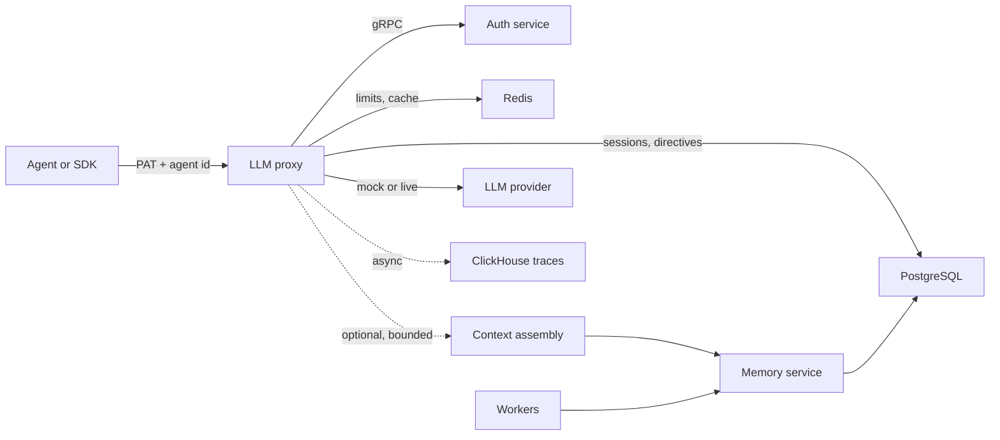

IBEX Harness sits between agents and language models. It authenticates the caller, scopes every operation to one tenant, injects a bounded context package, persists durable memory, and records evidence about what happened.

The project is **implemented locally** and deliberately narrow about production claims. Hosted HA, measured p99 SLOs, restore drills, and end-to-end tenant-isolation acceptance remain open. Read [Status and evidence](/docs/architecture/status-and-evidence) before you treat any page as a production guarantee.

::callout
---
{"type":"info","title":"The one rule"}
---

  A capability is either evidenced in the repository or it is not. Local tests are not hosted acceptance. Design intent is not runtime behavior. Every page carries a status banner for this reason.

::

## Choose your path

::card-group
::card
---
{"title":"Run it locally","to":"/docs/getting-started/quickstart","icon":"i-lucide-terminal"}
---
Boot dependencies, migrate, seed a PAT, and send a mock completion in about five minutes.
::

::card
---
{"title":"Integrate the API","to":"/docs/api-reference/chat-completions","icon":"i-lucide-code"}
---
Chat completions, Responses, management routes, idempotency, and stable errors.
::

::card
---
{"title":"Understand the system","to":"/docs/architecture/overview","icon":"i-lucide-layout-dashboard"}
---
Services, request lifecycle, data model, and the trust boundaries between them.
::

::card
---
{"title":"Operate it","to":"/docs/operations/observability","icon":"i-lucide-activity"}
---
Metrics, traces, health checks, incidents, billing evidence, and limitations.
::
::

## What the platform does

| Layer | Responsibility | Start here |
| --- | --- | --- |
| **Identity** | Organizations, users, agents, PATs, permission bitmaps, provider credentials, operator sessions | [Auth](/docs/auth/overview) |
| **Edge** | OpenAI-compatible proxy, agent verification, rate limits, directives, sessions, provider routing, idempotency | [Proxy](/docs/proxy/overview) |
| **Memory** | Tenant-scoped writes, PII/quarantine, dedup, conflict candidates, pgvector search, feedback | [Memory](/docs/memory/overview) |
| **Context** | Budget, parallel retrieval, ranking, packing, safe formatting, bounded fallback | [Context assembly](/docs/context/overview) |
| **Intelligence** | Session extraction, embeddings, billing rollups, deletion orchestration, maintenance | [Workers](/docs/intelligence/workers) |
| **Operator surfaces** | Management API, Console, read-only MCP gateway, evidence relay | [Management API](/docs/api-reference/management-api) |

## Status at a glance

::status-badge{status="IMPLEMENTED"} **Implemented locally:** auth, proxy foundations, directives, sessions, idempotency, traces, the memory substrate, the embedder, the Management API, and a default-off read-only MCP operator gateway.

::status-badge{status="PROVISIONAL"} **Provisional:** context assembly, extraction workers, MCP memory tools, Console live reads, billing evidence, and the relay.

::status-badge{status="PROPOSED"} **Design only:** DecisionService, GLiNER, and governed side effects.

::status-badge{status="DEFERRED"} **Deferred:** graph memory, A2A, managed cloud, marketplace, and coding sandbox.

The authoritative table, acceptance rules, and open gaps live in [Status and evidence](/docs/architecture/status-and-evidence).

## How the request path fits together

The proxy is the critical path. Context retrieval is optional and must degrade rather than block inference. Identity checks fail closed; memory and context injection fail open to directive-only behavior.

## Verify before you trust

- [Status and evidence](/docs/architecture/status-and-evidence) — claim rules and current gates.
- [Production readiness](/docs/deployment/production-readiness) — what is missing before promotion.
- [Benchmarks](/benchmarks) — local measurements with workload and limitations attached.
- [Releases](/releases) — changelog history parsed from the repository.

Design rationale is not implementation evidence. When this documentation and the status ledger disagree, the ledger wins.
